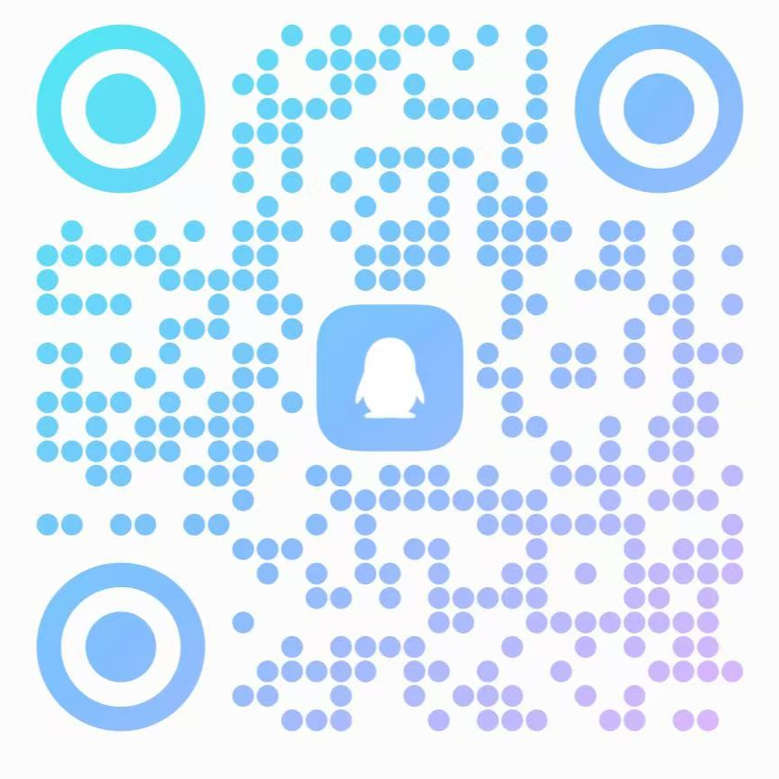
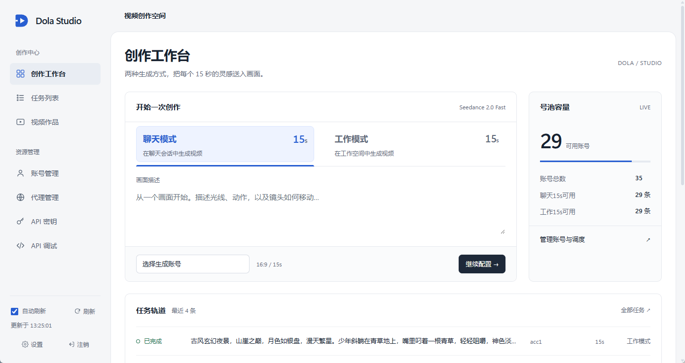

<p align="center">
  
</p>

<h1 align="center">Dola Studio</h1>

<p align="center">
  <strong>Doubao & Dola batch management · Chat / work modes · 15-second 720P video</strong><br>
  Extend Dola’s default 10-second workflow to 15 seconds, and connect your websites and apps through one API.
</p>

<p align="center">
  <a href="#overview"></a>
  <a href="#quick-start"></a>
  <a href="docs/DEPLOYMENT-API-REFERENCE.zh-CN.md#architecture"></a>
  <a href="#license"></a>
</p>


<a id="contents"></a>

<p align="center"><a href="docs/BEGINNER-GUIDE.zh-CN.md">Beginner guide (Chinese)</a> · <a href="#modes">Modes and quotas</a> · <a href="#quick-start">Quick start</a> · <a href="#api">API integration</a> · <a href="#documentation">Detailed documentation</a></p>

<p align="center"><a href="README.md">中文</a> · <strong>English</strong> · <a href="README.ja.md">日本語</a> · <a href="README.ko.md">한국어</a></p>

<a id="overview"></a>

## Overview

Dola Studio brings together **chat mode, work mode, dual-platform batch management, and a unified API**. Both Dola modes target **15-second video at 720P**: chat mode runs through a chat session, while work mode runs through a workspace. Manage Doubao and Dola accounts, proxies, tasks, and videos in one console, or integrate generation into your own websites and applications.

<a href="docs/assets/project-community-qr.png"></a>

**Four core capabilities:**

- **Chat mode · 15s 720P**: Generate through a dedicated Dola chat flow, with reference images and supported reference audio. Chat quota resets daily at **08:00 Beijing time (UTC+8)**.

- **Work mode · 15s 720P**: Generate through a Dola workspace with reference images. Work quota is independent and restores **7 days after use**, separately for each account.

- **Dual-platform batch management**: Import and verify accounts, assign proxies, manage scheduling, filter account status, and monitor tasks and videos. Task lists use 50 entries per page and support multiple pages.

- **Unified API**: Create video tasks, query progress, retrieve videos, and use Doubao image generation and editing. Business API keys and the built-in API playground support integration.

[Beginner guide (Chinese)](docs/BEGINNER-GUIDE.zh-CN.md)

Community: scan the QR code or search QQ group **647127178**.

<br clear="all">

<a id="features"></a>

## Interface language and appearance

The top-right controls switch between **light / dark** and **中文 / English / 日本語 / 한국어**. Preferences are saved in the current browser. Switching takes effect in place: it does not reload the page, clear forms, change modes, or interrupt background tasks. Account names, prompts, notes, API keys, protocol fields, and original upstream replies are never translated. Language selection is also available on the sign-in page.

Video upscaling is optional and **off by default**. Enabling it also requires a configured upscaling service.

<a id="console"></a>

## Console preview



Actual creation-workspace screenshot showing the two modes, account capacity, and task lanes. Counts and states in the image are not live service data.

<a id="beginner"></a>
<a id="modes"></a>
<a id="quota"></a>

## Modes and quotas

The following rules apply to **Dola accounts + Seedance 2.0 Fast + 15 seconds**.

| Item | Chat mode | Work mode |
| --- | --- | --- |
| Entry point | Dedicated 15s flow in a Dola chat session | Dola workspace / collaboration flow |
| Target video | 15s · 720P | 15s · 720P |
| Default quota | 1 video per account per day | 1 video per account per 7-day cycle |
| Quota recovery | Daily at **08:00 Beijing time** | **7 days after use**, per account |
| API mode field | `execution_mode: "chat"` | `execution_mode: "work"` |
| Reference material | Images; audio when supported by the model and workflow | Images; reference audio is currently unsupported |

- **Independent quotas:** using up chat quota does not use up work quota. Work quota does not reset with the daily 08:00 chat reset, nor on a shared weekday.

- **Video counts, not shared points:** the console shows a separate remaining-video count for each mode. Account health is separate from quota availability. Capacity summaries include only signed-in, schedulable, idle, unblocked accounts and do not double-count duplicates.

- **Upstream results are authoritative:** displayed quota does not guarantee successful submission or output. Explicit upstream recovery times take priority. Doubao quotas depend on its account type, model, and plan; API-key daily and concurrency limits are separate.

Both modes have historical **1280×720, approximately 15-second** successful outputs; see [live acceptance records](docs/LIVE-ACCEPTANCE.md). Account, proxy, session, and upstream conditions still affect results. Chat mode also uses a browser and is not a browser-free path.

<a id="quick-start"></a>

## Quick start

### Preparation and launch

Recommended: **Linux + Python 3.11+ + single-process Uvicorn**. Prepare Node.js, FFmpeg / ffprobe, browser binaries, and their system dependencies. The 15s workflows need the appropriate browser environment; configure Xvfb if necessary.

```bash
git clone git@github.com:sailsships/dola-studio.git
cd dola-studio
python3 -m venv .venv
source .venv/bin/activate
python -m pip install -r requirements.txt
cp .env.example .env.local
```

Edit `.env.local`: replace example API keys and set the real service URL, proxies, and runtime paths. The data directory must be writable. The example is a low-concurrency integration template, not production-ready configuration. This private repository requires access permission.

Once the browser environment is ready, launch from the repository root:

```bash
uvicorn server:app --host 127.0.0.1 --port 8002
```

Open <http://127.0.0.1:8002>. Change the initial administrator password on first use. Use a reverse proxy and HTTPS for remote deployment. See the [deployment reference (Chinese)](docs/DEPLOYMENT-API-REFERENCE.zh-CN.md#quick-start) for browser setup, display environment, configuration, and services.

### Generate your first video

1. Add a valid Dola account in Accounts, bind a working proxy, and verify the session.
2. Open Creation studio and select the account and chat or work mode.
3. Select **Seedance 2.0 Fast, 15 seconds, 1 video**. Start with text only.
4. Click Generate once, save the task ID, and follow it in Tasks.
5. Play the result in Videos and verify its duration, dimensions, and content.

Test generation also submits real tasks and consumes upstream quota. Closing a dialog does not cancel a background task.

<a id="api"></a>

## API integration

Create a business key under API keys and allow the required duration. Do not use an administrator login session in place of a business key. Save the following as UTF-8 `request.json`:

```json
{
  "model": "seedance-2.0-fast",
  "execution_mode": "chat",
  "prompt": "清晨湖面，远山与薄雾，固定机位，画面稳定，写实自然风景。",
  "duration": 15,
  "ratio": "16:9",
  "video_count": 1,
  "reference_source": "unspecified"
}
```

Set your real `DOLA_BASE_URL` and `DOLA_API_KEY` locally, then create one task:

```bash
curl --fail-with-body --silent --show-error \
  --request POST "${DOLA_BASE_URL%/}/v1/videos/generations" \
  --header "Authorization: Bearer ${DOLA_API_KEY}" \
  --header "Content-Type: application/json; charset=utf-8" \
  --data-binary @request.json
```

Save the returned `id` as `DOLA_TASK_ID` and query that same task:

```bash
curl --fail-with-body --silent --show-error \
  "${DOLA_BASE_URL%/}/v1/videos/${DOLA_TASK_ID}" \
  --header "Authorization: Bearer ${DOLA_API_KEY}"
```

Use `execution_mode: "work"` for work mode. After completion, read `video_url` or `videos`. If a create request times out, first check whether it was accepted; **do not repeatedly resubmit POST requests**. Reference files, image APIs, error handling, OpenAI-style routes, and Ark formats are covered in the [API reference (Chinese)](docs/DEPLOYMENT-API-REFERENCE.zh-CN.md#api). Compatible routes do not imply full compatibility with every SDK.

<a id="documentation"></a>

## Detailed documentation

The four README versions cover the same core workflow. Detailed operational documents below are currently primarily in Chinese.

- [Beginner guide (Chinese)](docs/BEGINNER-GUIDE.zh-CN.md)

- [Deployment and API reference](docs/DEPLOYMENT-API-REFERENCE.zh-CN.md)

- [Complete project guide](docs/PROJECT-GUIDE.zh-CN.md)

- [API route index](docs/reference/API-ROUTES.zh-CN.md)

- [Environment variable index](docs/reference/ENVIRONMENT.zh-CN.md)

- [Request / response models](docs/reference/DATA-MODELS.zh-CN.md)

- [Database index](docs/reference/DATABASE.zh-CN.md)

- [Live acceptance records](docs/LIVE-ACCEPTANCE.md)

- [Background refresh design](docs/REFRESH-ARCHITECTURE.md)

- [Upscaling integration](UPSCALE.md)

<a id="models"></a>
<a id="architecture"></a>
<a id="configuration"></a>
<a id="deployment"></a>
<a id="maintenance"></a>
<a id="development"></a>
<a id="faq"></a>

## FAQ

**Why can generation fail even when an account is healthy?**

Session validity, mode-specific quota, proxy connectivity, model permission, and account occupancy are separate checks. Wait for quota recovery or choose another supported mode with quota remaining.

**Can I resubmit after a timeout or after closing the dialog?**

First query the original task or check whether it was accepted. Closing the dialog does not cancel it. Resubmitting an unknown result can create duplicate tasks.

**Are Docker and Windows fully supported for both modes?**

Linux source deployment is currently recommended; account-browser locking depends on `fcntl`. Full Docker and clean-install workflows have not all been verified. Successful dependency installation alone does not establish working video generation.

<a id="verification"></a>

**Does version 1.0.1 guarantee every feature indefinitely?**

No. Historical outputs confirm both modes, not every account or parameter combination. This language and appearance update does not submit new upstream video-generation tasks. See the [verification scope (Chinese)](docs/DEPLOYMENT-API-REFERENCE.zh-CN.md#verification).

<a id="contributing"></a>

## Feedback and contributions

Include the version, reproduction steps, execution mode, model, task ID, error code, and last stage. For UI issues, include browser details and screenshots. Do not publish passwords, cookies, API keys, proxy credentials, databases, or private keys. Retry-related changes should explain how existing upstream sessions are handled.

<a id="license"></a>

## Licensing and attribution

- Original code: preserve the copyright and MIT notice for `Roins-hub and contributors` in [LICENSE](LICENSE).

- Own contributions: attributed to Dola Studio under the MIT terms in [CUSTOM_LICENSE.md](CUSTOM_LICENSE.md).

- Sources and resource boundaries: [THIRD_PARTY_NOTICES.md](THIRD_PARTY_NOTICES.md), [NOTICE.md](NOTICE.md), and the [attribution inventory](docs/ATTRIBUTION-INVENTORY.md). Third-party resources retain their own licenses.

The interface uses operating-system fonts and does not redistribute their font files.
