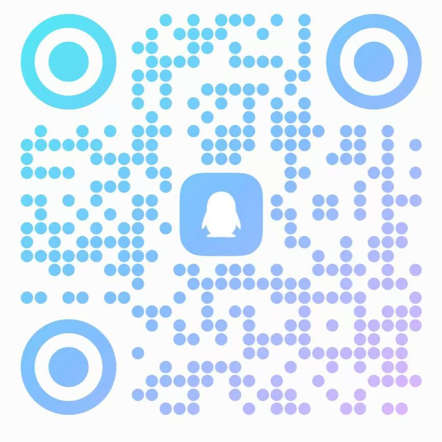
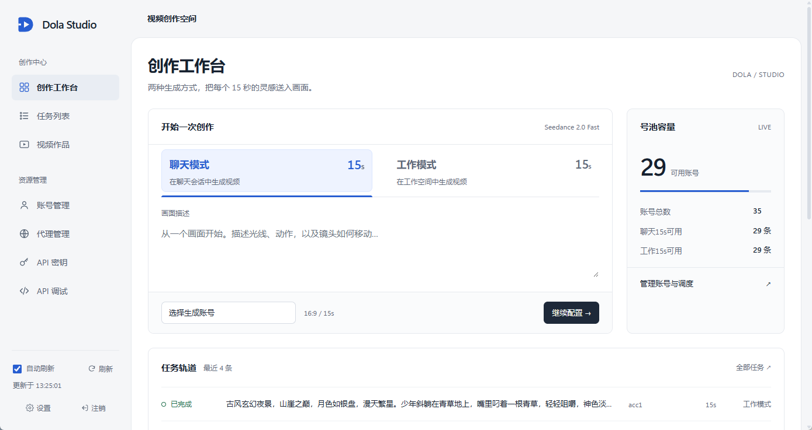

<p align="center">
  
</p>

<h1 align="center">Dola Studio</h1>

<p align="center">
  <strong>豆包・Dolaの一括管理 · チャット／ワークの2モード · 15秒720P動画</strong><br>
  Dolaの標準10秒の生成フローを15秒へ拡張し、統一APIでWebサイトやアプリに接続します。
</p>

<p align="center">
  <a href="#overview"></a>
  <a href="#quick-start"></a>
  <a href="docs/DEPLOYMENT-API-REFERENCE.zh-CN.md#architecture"></a>
  <a href="#license"></a>
</p>


<a id="contents"></a>

<p align="center"><a href="docs/BEGINNER-GUIDE.zh-CN.md">初心者ガイド（中国語）</a> · <a href="#modes">モードと利用枠</a> · <a href="#quick-start">クイックスタート</a> · <a href="#api">API連携</a> · <a href="#documentation">詳細ドキュメント</a></p>

<p align="center"><a href="README.md">中文</a> · <a href="README.en.md">English</a> · <strong>日本語</strong> · <a href="README.ko.md">한국어</a></p>

<a id="overview"></a>

## プロジェクト紹介

Dola Studioは、<strong>チャットモード、ワークモード、2プラットフォームの一括管理、統一API</strong>を備えた管理ツールです。Dolaではチャット経由とワークスペース経由の2つの生成フローで、<strong>15秒・720P</strong>の動画を生成します。豆包とDolaのアカウント、プロキシ、タスク、動画を一元管理し、独自のWebサイトやアプリからも利用できます。

<a href="docs/assets/project-community-qr.png"></a>

<strong>4つの主要機能:</strong>

- <strong>チャットモード · 15秒720P</strong>: Dolaのチャット専用フローで生成します。参照画像と、条件を満たす参照音声に対応します。利用枠は毎日<strong>北京時間08:00（UTC+8）</strong>にリセットされます。

- <strong>ワークモード · 15秒720P</strong>: Dolaのワークスペースで生成し、参照画像に対応します。利用枠は独立しており、アカウントごとに<strong>使用時点から7日後</strong>に回復します。

- <strong>2プラットフォームの一括管理</strong>: アカウントの追加・検証、プロキシ設定、タスク割り当て、状態の絞り込み、進捗確認、動画のプレビューとダウンロードに対応します。タスク一覧は1ページ50件で、複数ページを表示できます。

- <strong>統一API</strong>: 動画タスクの作成・照会・取得と、豆包の画像生成・編集に対応します。業務用APIキーと内蔵のAPIデバッグ画面で連携できます。

[初心者ガイド（中国語）](docs/BEGINNER-GUIDE.zh-CN.md)

交流：QRコードを読み取るか、QQグループ <strong>647127178</strong> を検索してください。

<br clear="all">

<a id="features"></a>

## 表示言語と外観

右上のボタンで<strong>ライト／ダーク</strong>と<strong>中文／English／日本語／한국어</strong>を切り替えられます。設定は現在のブラウザーに保存されます。切り替え時にページを再読み込みせず、フォーム、生成モード、バックグラウンドタスクを保持します。アカウント名、プロンプト、メモ、APIキー、プロトコルのフィールド、上流サービスの原文は翻訳しません。ログイン画面でも言語を選択できます。

動画の高解像度化はオプションで、<strong>初期状態では無効</strong>です。利用するには対応サービスの設定が必要です。

<a id="console"></a>

## 画面プレビュー



2つのモード、アカウント容量、タスク一覧を示す実際の制作画面です。画像内の件数や状態は現在のサービス状態を表すものではありません。

<a id="beginner"></a>
<a id="modes"></a>
<a id="quota"></a>

## モードと利用枠

以下は<strong>Dolaアカウント＋Seedance 2.0 Fast＋15秒</strong>の場合です。

| 項目 | チャットモード | ワークモード |
| --- | --- | --- |
| 実行経路 | Dolaチャット内の15秒専用フロー | Dolaワークスペース／共同作業フロー |
| 生成目標 | 15s · 720P | 15s · 720P |
| 標準の利用枠 | 1アカウントにつき1日1本 | 1アカウントにつき7日間で1本 |
| 回復時点 | 毎日<strong>北京時間08:00</strong> | 各アカウントの<strong>使用時点から7日後</strong> |
| APIのモード指定 | `execution_mode: "chat"` | `execution_mode: "work"` |
| 参照素材 | 画像。条件を満たす場合は音声も対応 | 画像。現在、参照音声は非対応 |

- <strong>利用枠は独立しています。</strong>チャット枠を使い切ってもワーク枠は別に残ります。ワーク枠は毎日08:00にも、全アカウント共通の曜日にもリセットされません。

- <strong>共有ポイントではなく本数で表示します。</strong>モード別に残り本数を表示し、アカウント状態と利用枠は分けて扱います。容量集計にはログイン済み・割り当て有効・空き状態・制限なしのアカウントのみを含め、重複は数えません。

- <strong>実際の上流応答が基準です。</strong>残り枠があっても送信や生成の成功は保証されません。明示された回復時刻を優先します。豆包にはアカウント種別・モデル・プランごとの規則があり、APIキーの日次上限・同時実行上限も別に適用されます。

両モードには<strong>1280×720・約15秒</strong>の生成実績があります。[実機検証記録](docs/LIVE-ACCEPTANCE.md)を参照してください。結果はアカウント、プロキシ、ログイン状態、上流サービスの状態に依存します。チャットモードもブラウザーを使用します。

<a id="quick-start"></a>

## クイックスタート

### 準備と起動

推奨構成は<strong>Linux＋Python 3.11以上＋Uvicorn単一プロセス</strong>です。Node.js、FFmpeg／ffprobe、ブラウザーとシステム依存関係を準備してください。15秒フローには対応するブラウザー環境が必要です。必要に応じてXvfbを設定します。

```bash
git clone git@github.com:sailsships/dola-studio.git
cd dola-studio
python3 -m venv .venv
source .venv/bin/activate
python -m pip install -r requirements.txt
cp .env.example .env.local
```

`.env.local`のAPIキー例を置き換え、実際のURL、プロキシ、実行パスを設定してください。データディレクトリへの書き込み権限が必要です。サンプルは低並列の連携確認用であり、本番設定ではありません。非公開リポジトリの取得にはアクセス権が必要です。

ブラウザー環境の準備後、リポジトリのルートで起動します。

```bash
uvicorn server:app --host 127.0.0.1 --port 8002
```

<http://127.0.0.1:8002>を開き、初回に管理者の初期パスワードを変更してください。リモート公開ではリバースプロキシとHTTPSを使用します。ブラウザー、画面環境、設定、サービスは[デプロイ参考資料（中国語）](docs/DEPLOYMENT-API-REFERENCE.zh-CN.md#quick-start)を参照してください。

### 最初の動画を生成

1. アカウント管理で有効なDolaアカウントを追加し、利用可能なプロキシを設定して検証します。
2. 制作ワークベンチでアカウントとチャット／ワークモードを選びます。
3. <strong>Seedance 2.0 Fast・15秒・1本</strong>を選び、最初はテキストのみで試します。
4. 生成開始を1回だけ押し、タスクIDを保存してタスク一覧で進捗を確認します。
5. 動画作品で実際に再生し、長さ、解像度、内容を確認します。

テスト生成も実際のタスクを送信し、上流サービスの利用枠を消費します。ダイアログを閉じてもバックグラウンドタスクは中止されません。

<a id="api"></a>

## API連携

APIキー画面で業務用キーを作成し、必要な動画の長さを許可します。管理者ログインセッションを業務用キーの代わりに使わないでください。以下をUTF-8の`request.json`として保存します。

```json
{
  "model": "seedance-2.0-fast",
  "execution_mode": "chat",
  "prompt": "清晨湖面，远山与薄雾，固定机位，画面稳定，写实自然风景。",
  "duration": 15,
  "ratio": "16:9",
  "video_count": 1,
  "reference_source": "unspecified"
}
```

ローカル環境で実際の`DOLA_BASE_URL`と`DOLA_API_KEY`を設定し、タスクを1件作成します。

```bash
curl --fail-with-body --silent --show-error \
  --request POST "${DOLA_BASE_URL%/}/v1/videos/generations" \
  --header "Authorization: Bearer ${DOLA_API_KEY}" \
  --header "Content-Type: application/json; charset=utf-8" \
  --data-binary @request.json
```

返された`id`を`DOLA_TASK_ID`に保存し、同じタスクを照会します。

```bash
curl --fail-with-body --silent --show-error \
  "${DOLA_BASE_URL%/}/v1/videos/${DOLA_TASK_ID}" \
  --header "Authorization: Bearer ${DOLA_API_KEY}"
```

ワークモードでは`execution_mode: "work"`を使います。完了後に`video_url`または`videos`を取得してください。作成リクエストがタイムアウトした場合は受理状況を先に確認し、<strong>POSTを繰り返し送信しないでください</strong>。参照素材、画像API、エラー処理、OpenAI風のルート、Ark形式は[API参考資料（中国語）](docs/DEPLOYMENT-API-REFERENCE.zh-CN.md#api)に記載しています。互換ルートがあっても、すべてのSDKとの完全互換を意味しません。

<a id="documentation"></a>

## 詳細ドキュメント

4言語版のREADMEは同じ基本フローを説明しています。以下の詳細な運用資料は現在、主に中国語です。

- [初心者ガイド（中国語）](docs/BEGINNER-GUIDE.zh-CN.md)

- [デプロイとAPI参考資料](docs/DEPLOYMENT-API-REFERENCE.zh-CN.md)

- [プロジェクト総合ガイド](docs/PROJECT-GUIDE.zh-CN.md)

- [APIルート一覧](docs/reference/API-ROUTES.zh-CN.md)

- [環境変数一覧](docs/reference/ENVIRONMENT.zh-CN.md)

- [リクエスト／レスポンスモデル](docs/reference/DATA-MODELS.zh-CN.md)

- [データベース一覧](docs/reference/DATABASE.zh-CN.md)

- [実機検証記録](docs/LIVE-ACCEPTANCE.md)

- [バックグラウンド更新設計](docs/REFRESH-ARCHITECTURE.md)

- [高解像度化の連携](UPSCALE.md)

<a id="models"></a>
<a id="architecture"></a>
<a id="configuration"></a>
<a id="deployment"></a>
<a id="maintenance"></a>
<a id="development"></a>
<a id="faq"></a>

## よくある質問

<strong>アカウントが正常でも生成できないのはなぜですか？</strong>

ログイン状態、モード別の利用枠、プロキシ接続、モデル権限、アカウントの使用状況は別々の条件です。枠の回復を待つか、利用枠の残っている対応モードを選んでください。

<strong>タイムアウトや画面を閉じた後に再送信できますか？</strong>

元のタスクまたは受理状況を先に確認してください。画面を閉じてもタスクは中止されません。結果不明のまま再送信すると重複する可能性があります。

<strong>DockerやWindowsで両モードをそのまま利用できますか？</strong>

現在はLinuxのソース展開を推奨します。アカウント用ブラウザーのロックは`fcntl`に依存します。Docker全体とクリーンインストールの全手順は未検証です。依存関係のインストール成功だけでは動画生成の動作確認にはなりません。

<a id="verification"></a>

<strong>バージョン1.0.1で全機能の継続動作を保証しますか？</strong>

保証ではありません。両モードの生成実績はありますが、すべてのアカウントや設定の組み合わせを検証したものではありません。今回の言語・外観更新では上流サービスへ新しい動画生成を送信しません。[検証範囲（中国語）](docs/DEPLOYMENT-API-REFERENCE.zh-CN.md#verification)を参照してください。

<a id="contributing"></a>

## フィードバックと貢献

バージョン、再現手順、実行モード、モデル、タスクID、エラーコード、最後の段階を記載してください。UIの問題にはブラウザー情報とスクリーンショットを添付してください。パスワード、Cookie、APIキー、プロキシ認証情報、データベース、秘密鍵は公開しないでください。再試行に関する変更は既存の上流セッションの扱いを説明してください。

<a id="license"></a>

## ライセンスと帰属

- 元のコード：[LICENSE](LICENSE)の`Roins-hub and contributors`の著作権表記とMITライセンスを保持します。

- 独自の貢献：Dola Studio名義で、[CUSTOM_LICENSE.md](CUSTOM_LICENSE.md)のMIT条件を適用します。

- 出典とリソースの範囲：[THIRD_PARTY_NOTICES.md](THIRD_PARTY_NOTICES.md)、[NOTICE.md](NOTICE.md)、[帰属一覧](docs/ATTRIBUTION-INVENTORY.md)を参照してください。第三者のリソースにはそれぞれのライセンスを適用します。

画面にはOSのフォントを使用し、フォントファイルは同梱しません。
