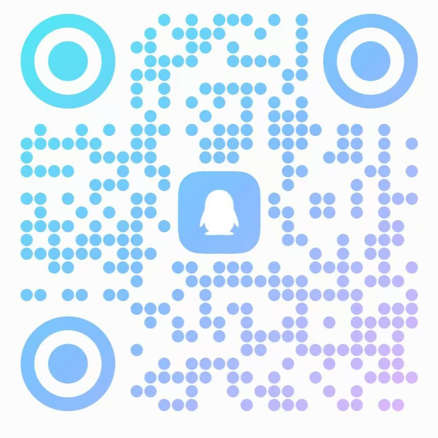
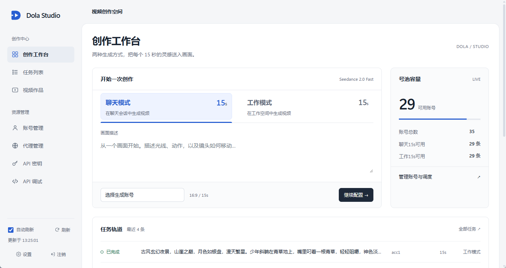

<p align="center">
  
</p>

<h1 align="center">Dola Studio</h1>

<p align="center">
  <strong>Doubao·Dola 일괄 관리 · 채팅/작업 두 모드 · 15초 720P 영상</strong><br>
  Dola의 기본 10초 생성 흐름을 15초로 확장하고, 통합 API로 웹사이트와 앱에 연결합니다.
</p>

<p align="center">
  <a href="#overview"></a>
  <a href="#quick-start"></a>
  <a href="docs/DEPLOYMENT-API-REFERENCE.zh-CN.md#architecture"></a>
  <a href="#license"></a>
</p>


<a id="contents"></a>

<p align="center"><a href="docs/BEGINNER-GUIDE.zh-CN.md">초보자 가이드(중국어)</a> · <a href="#modes">모드 및 할당량</a> · <a href="#quick-start">빠른 시작</a> · <a href="#api">API 연동</a> · <a href="#documentation">상세 문서</a></p>

<p align="center"><a href="README.md">中文</a> · <a href="README.en.md">English</a> · <a href="README.ja.md">日本語</a> · <strong>한국어</strong></p>

<a id="overview"></a>

## 프로젝트 소개

Dola Studio는 <strong>채팅 모드, 작업 모드, 두 플랫폼 일괄 관리, 통합 API</strong>를 제공하는 관리 도구입니다. Dola에서 채팅 세션과 작업 공간의 두 생성 흐름을 통해 <strong>15초·720P</strong> 영상을 생성합니다. Doubao와 Dola의 계정, 프록시, 작업, 영상을 한곳에서 관리하고 자체 웹사이트나 앱에서도 이용할 수 있습니다.

<a href="docs/assets/project-community-qr.png"></a>

<strong>네 가지 핵심 기능:</strong>

- <strong>채팅 모드 · 15초 720P</strong>: Dola 전용 채팅 흐름으로 생성하며 참조 이미지와 조건에 맞는 참조 오디오를 지원합니다. 할당량은 매일 <strong>베이징 시간 08:00(UTC+8)</strong>에 초기화됩니다.

- <strong>작업 모드 · 15초 720P</strong>: Dola 작업 공간에서 생성하며 참조 이미지를 지원합니다. 할당량은 별도로 관리되며 계정별로 <strong>사용 시점부터 7일 후</strong> 복구됩니다.

- <strong>두 플랫폼 일괄 관리</strong>: 계정 추가·확인, 프록시 연결, 스케줄 관리, 상태 필터링, 진행 상황 확인, 영상 미리보기 및 다운로드를 지원합니다. 작업 목록은 페이지당 50개이며 여러 페이지를 지원합니다.

- <strong>통합 API</strong>: 영상 작업 생성·조회·결과 가져오기와 Doubao 이미지 생성·편집을 지원합니다. 업무용 API 키와 내장 API 디버깅 화면으로 연동할 수 있습니다.

[초보자 가이드(중국어)](docs/BEGINNER-GUIDE.zh-CN.md)

커뮤니티: QR 코드를 스캔하거나 QQ 그룹 <strong>647127178</strong>을 검색하세요.

<br clear="all">

<a id="features"></a>

## 화면 언어 및 테마

오른쪽 위에서 <strong>라이트/다크</strong> 테마와 <strong>中文/English/日本語/한국어</strong>를 선택할 수 있습니다. 설정은 현재 브라우저에 저장됩니다. 전환 시 페이지를 새로 고치지 않으며 입력 양식, 생성 모드, 백그라운드 작업을 유지합니다. 계정 이름, 프롬프트, 메모, API 키, 프로토콜 필드, 상위 서비스 원문은 번역하지 않습니다. 로그인 화면에서도 언어를 선택할 수 있습니다.

영상 업스케일링은 선택 기능이며 <strong>기본적으로 꺼져 있습니다</strong>. 사용하려면 별도 서비스 설정이 필요합니다.

<a id="console"></a>

## 화면 미리보기



두 모드, 계정 용량, 작업 목록을 보여 주는 실제 제작 화면입니다. 이미지의 수치와 상태는 현재 서비스 상태가 아닙니다.

<a id="beginner"></a>
<a id="modes"></a>
<a id="quota"></a>

## 모드 및 할당량

아래 규칙은 <strong>Dola 계정 + Seedance 2.0 Fast + 15초</strong>에 적용됩니다.

| 항목 | 채팅 모드 | 작업 모드 |
| --- | --- | --- |
| 실행 경로 | Dola 채팅의 15초 전용 흐름 | Dola 작업 공간/협업 흐름 |
| 목표 영상 | 15s · 720P | 15s · 720P |
| 기본 할당량 | 계정당 하루 1개 | 계정당 7일 주기 1개 |
| 복구 시점 | 매일 <strong>베이징 시간 08:00</strong> | 계정별 <strong>사용 시점부터 7일 후</strong> |
| API 모드 필드 | `execution_mode: "chat"` | `execution_mode: "work"` |
| 참조 자료 | 이미지, 모델과 흐름이 지원하는 경우 오디오 | 이미지, 현재 참조 오디오는 지원하지 않음 |

- <strong>할당량은 서로 독립적입니다.</strong> 채팅 할당량을 모두 사용해도 작업 할당량은 별개입니다. 작업 할당량은 매일 08:00이나 공통 요일에 초기화되지 않습니다.

- <strong>공유 포인트가 아닌 영상 개수로 표시합니다.</strong> 모드별 남은 개수를 표시하며 계정 상태와 할당량은 구분합니다. 용량 집계에는 로그인 완료, 스케줄 사용, 유휴 상태, 제한 없는 계정만 포함하며 중복 계정은 중복 집계하지 않습니다.

- <strong>상위 서비스의 실제 응답을 기준으로 합니다.</strong> 잔여 할당량이 있어도 제출이나 생성 성공을 보장하지 않습니다. 명시된 복구 시간을 우선 적용합니다. Doubao는 계정 유형·모델·요금제 규칙을 따르며 API 키의 일일·동시 실행 제한도 별도입니다.

두 모드 모두 <strong>1280×720, 약 15초</strong>의 실제 생성 기록이 있습니다. [실제 검증 기록](docs/LIVE-ACCEPTANCE.md)을 참고하세요. 계정, 프록시, 로그인 세션, 상위 서비스 상태에 따라 결과가 달라집니다. 채팅 모드도 브라우저를 사용합니다.

<a id="quick-start"></a>

## 빠른 시작

### 준비 및 실행

권장 구성은 <strong>Linux + Python 3.11 이상 + 단일 프로세스 Uvicorn</strong>입니다. Node.js, FFmpeg/ffprobe, 브라우저 바이너리 및 시스템 의존성을 준비하세요. 15초 흐름에는 해당 브라우저 환경이 필요하며 필요시 Xvfb를 설정합니다.

```bash
git clone git@github.com:sailsships/dola-studio.git
cd dola-studio
python3 -m venv .venv
source .venv/bin/activate
python -m pip install -r requirements.txt
cp .env.example .env.local
```

`.env.local`의 예제 API 키를 바꾸고 실제 URL, 프록시, 실행 경로를 설정하세요. 데이터 디렉터리에 쓰기 권한이 있어야 합니다. 예제는 낮은 동시 실행의 연동 테스트용이며 운영 설정이 아닙니다. 비공개 저장소 접근 권한이 필요합니다.

브라우저 환경을 준비한 뒤 저장소 루트에서 실행하세요.

```bash
uvicorn server:app --host 127.0.0.1 --port 8002
```

<http://127.0.0.1:8002>를 열고 처음 사용할 때 초기 관리자 비밀번호를 변경하세요. 원격 배포 시 리버스 프록시와 HTTPS를 사용합니다. 브라우저, 화면 환경, 설정, 서비스는 [배포 참고 문서(중국어)](docs/DEPLOYMENT-API-REFERENCE.zh-CN.md#quick-start)를 확인하세요.

### 첫 영상 생성

1. 계정 관리에서 유효한 Dola 계정을 추가하고 사용 가능한 프록시를 연결한 뒤 확인합니다.
2. 창작 작업대에서 계정과 채팅/작업 모드를 선택합니다.
3. <strong>Seedance 2.0 Fast, 15초, 영상 1개</strong>를 선택하고 처음에는 텍스트만 사용합니다.
4. 생성 시작을 한 번만 누르고 작업 ID를 저장한 뒤 작업 목록에서 진행 상황을 확인합니다.
5. 영상 작품에서 실제로 재생하여 길이, 해상도, 내용을 확인합니다.

테스트 생성도 실제 작업을 제출하며 상위 서비스 할당량을 사용합니다. 창을 닫아도 백그라운드 작업은 취소되지 않습니다.

<a id="api"></a>

## API 연동

API 키 화면에서 업무용 키를 만들고 필요한 영상 길이를 허용하세요. 관리자 로그인 세션을 업무용 키 대신 사용하지 마세요. 아래를 UTF-8 `request.json`으로 저장합니다.

```json
{
  "model": "seedance-2.0-fast",
  "execution_mode": "chat",
  "prompt": "清晨湖面，远山与薄雾，固定机位，画面稳定，写实自然风景。",
  "duration": 15,
  "ratio": "16:9",
  "video_count": 1,
  "reference_source": "unspecified"
}
```

로컬에서 실제 `DOLA_BASE_URL`과 `DOLA_API_KEY`를 설정한 뒤 작업을 한 번 생성합니다.

```bash
curl --fail-with-body --silent --show-error \
  --request POST "${DOLA_BASE_URL%/}/v1/videos/generations" \
  --header "Authorization: Bearer ${DOLA_API_KEY}" \
  --header "Content-Type: application/json; charset=utf-8" \
  --data-binary @request.json
```

반환된 `id`를 `DOLA_TASK_ID`로 저장하고 같은 작업을 조회합니다.

```bash
curl --fail-with-body --silent --show-error \
  "${DOLA_BASE_URL%/}/v1/videos/${DOLA_TASK_ID}" \
  --header "Authorization: Bearer ${DOLA_API_KEY}"
```

작업 모드는 `execution_mode: "work"`를 사용합니다. 완료 후 `video_url` 또는 `videos`를 가져오세요. 생성 요청이 시간 초과되면 먼저 접수 여부를 확인하고 <strong>POST 요청을 반복 제출하지 마세요</strong>. 참조 자료, 이미지 API, 오류 처리, OpenAI 스타일 경로, Ark 형식은 [API 참고 문서(중국어)](docs/DEPLOYMENT-API-REFERENCE.zh-CN.md#api)에 설명되어 있습니다. 호환 경로가 모든 SDK의 완전 호환을 의미하지는 않습니다.

<a id="documentation"></a>

## 상세 문서

네 언어 README는 동일한 핵심 흐름을 설명합니다. 아래 상세 운영 문서는 현재 주로 중국어입니다.

- [초보자 가이드(중국어)](docs/BEGINNER-GUIDE.zh-CN.md)

- [배포 및 API 참고 문서](docs/DEPLOYMENT-API-REFERENCE.zh-CN.md)

- [전체 프로젝트 가이드](docs/PROJECT-GUIDE.zh-CN.md)

- [API 경로 색인](docs/reference/API-ROUTES.zh-CN.md)

- [환경 변수 색인](docs/reference/ENVIRONMENT.zh-CN.md)

- [요청/응답 모델](docs/reference/DATA-MODELS.zh-CN.md)

- [데이터베이스 색인](docs/reference/DATABASE.zh-CN.md)

- [실제 검증 기록](docs/LIVE-ACCEPTANCE.md)

- [백그라운드 새로고침 설계](docs/REFRESH-ARCHITECTURE.md)

- [업스케일링 연동](UPSCALE.md)

<a id="models"></a>
<a id="architecture"></a>
<a id="configuration"></a>
<a id="deployment"></a>
<a id="maintenance"></a>
<a id="development"></a>
<a id="faq"></a>

## 자주 묻는 질문

<strong>계정이 정상인데 생성이 실패하는 이유는 무엇인가요?</strong>

로그인 세션, 모드별 할당량, 프록시 연결, 모델 권한, 계정 사용 상태는 각각 별도 조건입니다. 할당량 복구를 기다리거나 잔여 할당량이 있는 지원 모드를 선택하세요.

<strong>시간 초과나 창을 닫은 뒤 다시 제출해도 되나요?</strong>

먼저 원래 작업이나 접수 여부를 확인하세요. 창을 닫아도 작업은 취소되지 않습니다. 결과를 모른 채 재제출하면 중복 작업이 생길 수 있습니다.

<strong>Docker나 Windows에서 두 모드를 바로 사용할 수 있나요?</strong>

현재는 Linux 소스 배포를 권장하며 계정 브라우저 잠금은 `fcntl`에 의존합니다. 전체 Docker 및 신규 설치 절차는 모두 검증되지 않았습니다. 의존성 설치 성공만으로 영상 생성 동작을 보장할 수 없습니다.

<a id="verification"></a>

<strong>1.0.1이 모든 기능의 지속적인 동작을 보장하나요?</strong>

보장하지 않습니다. 두 모드의 실제 생성 기록은 있지만 모든 계정·설정 조합을 검증한 것은 아닙니다. 이번 언어·테마 업데이트에서는 상위 서비스에 새 영상 생성 작업을 제출하지 않습니다. [검증 범위(중국어)](docs/DEPLOYMENT-API-REFERENCE.zh-CN.md#verification)를 참고하세요.

<a id="contributing"></a>

## 피드백 및 기여

버전, 재현 단계, 실행 모드, 모델, 작업 ID, 오류 코드, 마지막 단계를 포함해 주세요. UI 문제는 브라우저 정보와 스크린샷도 첨부해 주세요. 비밀번호, Cookie, API 키, 프록시 인증 정보, 데이터베이스, 개인 키는 공개하지 마세요. 재시도 관련 변경은 기존 상위 서비스 세션 처리 방식을 설명해야 합니다.

<a id="license"></a>

## 라이선스 및 출처

- 원본 코드: [LICENSE](LICENSE)의 `Roins-hub and contributors` 저작권 및 MIT 고지를 유지합니다.

- 자체 기여: Dola Studio 명의이며 [CUSTOM_LICENSE.md](CUSTOM_LICENSE.md)의 MIT 조건을 적용합니다.

- 출처 및 리소스 범위: [THIRD_PARTY_NOTICES.md](THIRD_PARTY_NOTICES.md), [NOTICE.md](NOTICE.md), [출처 목록](docs/ATTRIBUTION-INVENTORY.md)을 참고하세요. 타사 리소스에는 각 라이선스가 적용됩니다.

화면은 운영체제 글꼴을 사용하며 글꼴 파일을 재배포하지 않습니다.
