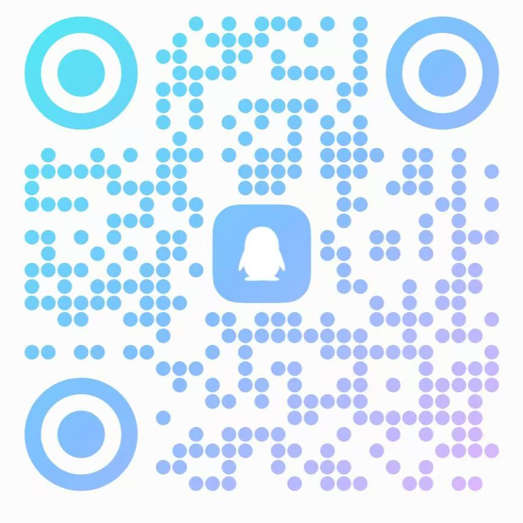
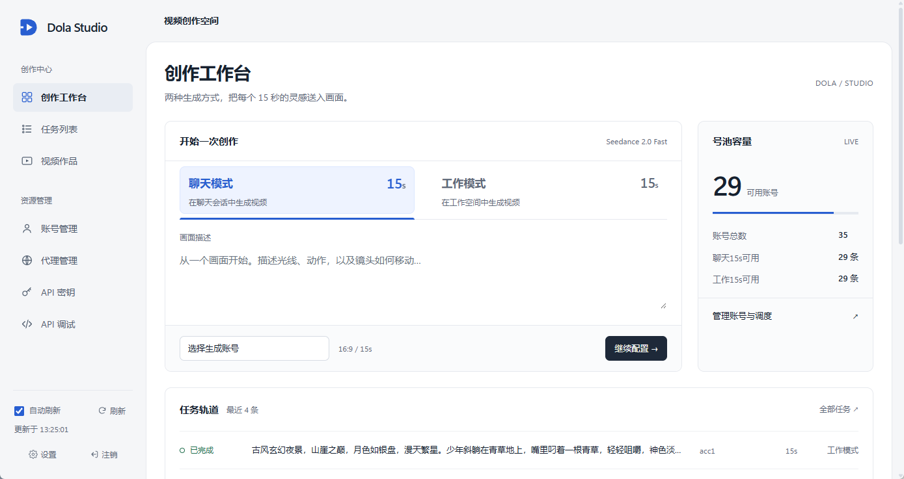

<p align="center">
  
</p>

<h1 align="center">Dola Studio</h1>

<p align="center">
  <strong>豆包与 Dola 批量管理 · 聊天 / 工作双模式 · 15 秒 720P 视频</strong><br>
  从默认 10 秒扩展至 15 秒，通过统一 API 接入其他网站与应用。
</p>

<p align="center">
  <a href="#overview"></a>
  <a href="#quick-start"></a>
  <a href="docs/DEPLOYMENT-API-REFERENCE.zh-CN.md#architecture"></a>
  <a href="#license"></a>
</p>

<a id="contents"></a>

<p align="center">
  <a href="docs/BEGINNER-GUIDE.zh-CN.md">新人指南</a> ·
  <a href="#modes">双模式与额度</a> ·
  <a href="#quick-start">快速开始</a> ·
  <a href="#api">API 接入</a> ·
  <a href="#documentation">详细文档</a>
</p>

<p align="center">
  <strong>中文</strong> · <a href="README.en.md">English</a> · <a href="README.ja.md">日本語</a> · <a href="README.ko.md">한국어</a>
</p>

<a id="overview"></a>

## 项目介绍

Dola Studio 围绕 **聊天模式、工作模式、双平台批量管理、统一 API** 四项核心能力构建。针对 Dola 默认 10 秒的视频生成限制，聊天模式通过聊天会话、工作模式通过工作空间，分别提供 **15 秒、720P** 视频生成方案；同时集中管理 **豆包与 Dola** 的账号、代理、任务和作品，让创作既能在管理界面完成，也能接入其他网站与应用。

<a href="docs/assets/project-community-qr.png"></a>

**四个重点：**

- **聊天模式 · 15 秒 720P**：通过 Dola 聊天会话的专用流程生成视频，支持参考图片及符合条件的参考音频；聊天额度每天北京时间 08:00 更新。
- **工作模式 · 15 秒 720P**：通过 Dola 工作空间生成视频，支持参考图片；工作额度独立管理，使用后按账号等待 7 天恢复。
- **双平台批量管理**：集中管理豆包与 Dola 账号、代理和调度，统一查看账号状态、剩余条数、任务进度与视频作品。
- **统一 API**：为其他网站、应用和脚本提供任务创建、进度查询与作品获取接口，配合业务密钥和内置调试说明完成接入。

第一次使用，先看 **[新人指南：两种模式从 10 秒到 15 秒](docs/BEGINNER-GUIDE.zh-CN.md)**。

**项目交流**：扫描右侧二维码，或搜索 QQ 群 **647127178**。

<br clear="all">

<a id="features"></a>

## 核心功能

| 能力 | 可以做什么 |
| --- | --- |
| 聊天模式 | 在 Dola 聊天会话中生成 15 秒 720P 视频，配置比例、参考图片及符合条件的参考音频 |
| 工作模式 | 在 Dola 工作空间中生成 15 秒 720P 视频，使用独立工作额度与参考图片流程 |
| 双平台批量管理 | 批量添加和验证账号、管理代理与调度、按状态筛选；后台同步任务，每页 50 条，预览和下载作品 |
| 统一 API | 创建和查询视频任务、获取作品、调用豆包图片生成与编辑；管理业务密钥并调试接入 |

视频超分是可选功能，**默认关闭**；开启后仍需配置相应服务。

### 界面语言与外观

管理台右上角提供 **白天 / 黑夜**模式和 **中文、English、日本語、한국어**语言选择。设置保存在当前浏览器，下次打开沿用；切换即时生效，不刷新页面、不重置已输入的表单、不改变后台任务。账号名、提示词、备注、API Key、接口字段与上游原始回执保持原样，不会被翻译。登录页也可选择语言。

四版 README 介绍相同的核心能力、额度、启动与 API 接入流程；下方详细运维文档目前以中文为主。

<a id="console"></a>

## 界面预览



创作工作台实拍截图，展示聊天 / 工作模式切换、账号容量与任务轨道；图中的数量与状态不代表实时服务状态。

<a id="beginner"></a>
<a id="modes"></a>
<a id="quota"></a>

## 双模式与额度

以下对照针对 **Dola 账号 + Seedance 2.0 Fast + 15 秒**：

| 对比项 | 聊天模式 | 工作模式 |
| --- | --- | --- |
| 执行入口 | Dola 聊天会话，进入专用 15 秒流程 | Dola 工作空间 / 协作入口 |
| 视频目标 | 15 秒、720P | 15 秒、720P |
| 默认额度 | 每账号每日 1 条 | 每账号 7 天 1 条 |
| 恢复时间 | 每天北京时间 **08:00** | 使用后按账号独立等待 **7 天** |
| API 模式字段 | `execution_mode: "chat"` | `execution_mode: "work"` |
| 参考素材 | 参考图片；符合条件时支持参考音频 | 参考图片，当前不支持参考音频 |

- **额度独立**：聊天用完不代表工作也用完；工作额度不随每天 08:00 的聊天更新一起重置，也不是统一在每周一刷新。
- **按条数显示**：分别显示“聊天15s：剩余 N 条”“工作15s：剩余 N 条”，不使用全平台共享点数。
- **状态与额度分开**：“正常”表示账号状态，不代表两种模式都有额度；工作台只汇总已登录、开启调度、当前空闲且无阻断状态的账号，重复项不重复计入。
- **以实际回执为准**：聊天条数结合配置及已知上游限制计算；工作恢复时间优先采用上游明确回执。条数可用不保证提交或出片成功。
- **不混用平台规则**：豆包按对应账号类型、模型和套餐处理，不套用上述 Dola 额度。API Key 的日限与并发限制也独立于账号额度。

两种模式各有真实 **1280×720、约 15 秒**成功作品，见[真实运行验收](docs/LIVE-ACCEPTANCE.md)。实际能力仍受账号、代理、登录态及上游状态影响；聊天模式同样会使用浏览器，不是零浏览器开销路径。

<a id="quick-start"></a>

## 快速开始

### 1. 准备与启动

推荐 **Linux + Python 3.11+ + 单进程 Uvicorn**。还需准备 Node.js、FFmpeg / ffprobe、所选路径的浏览器及系统依赖；15 秒流程需要相应浏览器环境，必要时配置 Xvfb。

```bash
git clone git@github.com:sailsships/dola-studio.git
cd dola-studio
python3 -m venv .venv
source .venv/bin/activate
python -m pip install -r requirements.txt
cp .env.example .env.local
```

编辑 `.env.local`，替换示例 API Key，设置实际访问地址、代理及运行路径，确认数据目录可写。示例配置是低并发联调模板，不等于生产配置；私有仓库需要对应访问权限。

浏览器二进制与系统环境就绪后，在仓库根目录启动：

```bash
uvicorn server:app --host 127.0.0.1 --port 8002
```

本机打开 <http://127.0.0.1:8002>。首次修改初始化管理员密码；远程部署使用反向代理与 HTTPS。浏览器、显示环境、配置和服务部署详见[部署与 API 参考](docs/DEPLOYMENT-API-REFERENCE.zh-CN.md#quick-start)。

### 2. 生成第一条视频

1. 在“账号管理”准备有效的 Dola 账号，绑定可用代理并完成验证。
2. 打开“创作工作台”，选择账号和聊天或工作模式。
3. 使用 **Seedance 2.0 Fast、15 秒、1 条视频**，首次先用纯文字。
4. 点击一次“开始生成”，保存任务 ID，在“任务列表”等待完成。
5. 到“视频作品”实际播放，核对时长、尺寸和结果。

“测试生成”也会真实提交并消耗上游额度。关闭弹窗不等于取消后台任务。

<a id="api"></a>

## API 接入

在管理台“API 密钥”创建业务 Key，并允许所需时长；不要用管理员登录会话替代业务 Key。将以下内容保存为 UTF-8 的 `request.json`：

```json
{
  "model": "seedance-2.0-fast",
  "execution_mode": "chat",
  "prompt": "清晨湖面，远山与薄雾，固定机位，画面稳定，写实自然风景。",
  "duration": 15,
  "ratio": "16:9",
  "video_count": 1,
  "reference_source": "unspecified"
}
```

在本地设置实际的 `DOLA_BASE_URL`、`DOLA_API_KEY`，再创建一次任务：

```bash
curl --fail-with-body --silent --show-error \
  --request POST "${DOLA_BASE_URL%/}/v1/videos/generations" \
  --header "Authorization: Bearer ${DOLA_API_KEY}" \
  --header "Content-Type: application/json; charset=utf-8" \
  --data-binary @request.json
```

保存返回的 `id` 到 `DOLA_TASK_ID`，查询同一任务：

```bash
curl --fail-with-body --silent --show-error \
  "${DOLA_BASE_URL%/}/v1/videos/${DOLA_TASK_ID}" \
  --header "Authorization: Bearer ${DOLA_API_KEY}"
```

将 `execution_mode` 改为 `work` 即为工作模式请求。任务成功完成后读取 `video_url` 或 `videos` 获取作品；请求超时应先核对是否已受理，**不要循环重发创建请求**。

支持相应 OpenAI 风格接口和 Ark 任务格式，不表示与任意 SDK 完全等价。更多端点、参考素材、图片生成与错误处理见[API 参考](docs/DEPLOYMENT-API-REFERENCE.zh-CN.md#api)。

<a id="documentation"></a>

## 详细文档

| 文档 | 内容 |
| --- | --- |
| [新人指南](docs/BEGINNER-GUIDE.zh-CN.md) | 账号准备、两种 15 秒模式、素材、结果核验与排障 |
| [部署与 API 参考](docs/DEPLOYMENT-API-REFERENCE.zh-CN.md) | 原首页完整运行说明：模型、配置、接口、部署、备份和开发 |
| [完整项目解说](docs/PROJECT-GUIDE.zh-CN.md) | 33 章产品操作、执行链与维护交接 |
| [API 路由索引](docs/reference/API-ROUTES.zh-CN.md) | 路径、处理器、鉴权入口及源码位置 |
| [环境变量索引](docs/reference/ENVIRONMENT.zh-CN.md) | 变量、默认表达式和读取位置 |
| [请求与响应模型](docs/reference/DATA-MODELS.zh-CN.md) / [数据库索引](docs/reference/DATABASE.zh-CN.md) | 参数结构、校验及持久化 |
| [真实运行验收](docs/LIVE-ACCEPTANCE.md) | 已验证结果、文件证据与未覆盖范围 |
| [刷新设计](docs/REFRESH-ARCHITECTURE.md) / [超分接入](UPSCALE.md) | 后台状态同步与可选后处理 |

<a id="models"></a>
<a id="architecture"></a>
<a id="configuration"></a>
<a id="deployment"></a>
<a id="maintenance"></a>
<a id="development"></a>

模型、架构、配置、部署、数据维护与开发章节已移至[部署与 API 参考](docs/DEPLOYMENT-API-REFERENCE.zh-CN.md)，原有详细说明仍可查阅。

<a id="faq"></a>

## 常见问题

**账号正常，为什么仍无法生成？**

登录状态、对应模式额度、代理、模型权限与账号占用是不同条件，需分别检查。额度不够时等待恢复，或选择仍有额度且具备能力的另一模式。

**API 超时或关闭弹窗后，可以重新提交吗？**

先查询原任务或在后台核对受理状态。弹窗关闭不会取消任务；结果未知时重提可能造成重复生成。

**可以直接用 Docker 或 Windows 跑双模式吗？**

当前推荐 Linux 源码部署，账号浏览器锁依赖 `fcntl`。完整 Docker 与从零安装流程尚未全部验收，不能仅凭依赖安装成功就认定双模式可用。

<a id="verification"></a>

**版本是否保证所有功能长期稳定？**

版本保持 **1.0.1**。两种模式有历史真实出片记录，但不等于所有账号与组合均成功。本次语言与外观更新不重新提交上游视频生成；详见[验证范围](docs/DEPLOYMENT-API-REFERENCE.zh-CN.md#verification)。

<a id="contributing"></a>

## 反馈与贡献

反馈时提供版本、复现步骤、模式、模型、任务 ID、错误码和最后执行阶段。UI 问题补充浏览器及截图。不要提交真实密码、Cookie、API Key、代理凭据、数据库或私钥；涉及重试的改动需说明已有上游会话如何处理。

<a id="license"></a>

## 许可与来源

- 原始代码：保留 [LICENSE](LICENSE) 中 `Roins-hub and contributors` 的版权与 MIT 许可声明。
- 自有贡献：署名 Dola Studio，采用 [CUSTOM_LICENSE.md](CUSTOM_LICENSE.md) 中的 MIT 许可。
- 来源及资源边界：见 [THIRD_PARTY_NOTICES.md](THIRD_PARTY_NOTICES.md)、[NOTICE.md](NOTICE.md) 和[归属清单](docs/ATTRIBUTION-INVENTORY.md)；第三方资源仍遵循各自许可。

当前界面使用操作系统字体栈，不打包分发系统字体文件。
