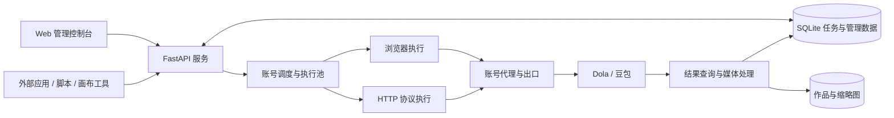

<p align="center">
  
</p>

<h1 align="center">Dola Studio</h1>

<p align="center">
  <strong>豆包与 Dola 批量管理 · 双模式生成 15 秒 720P 视频</strong><br>
  从默认 10 秒扩展至 15 秒，通过统一 API 接入其他网站与应用。
</p>

<p align="center">
  <a href="#overview"></a>
  <a href="#quick-start"></a>
  <a href="#architecture"></a>
  <a href="#deployment"></a>
  <a href="LICENSE"></a>
</p>

<p align="center">
  <a href="docs/BEGINNER-GUIDE.zh-CN.md">新人指南</a> ·
  <a href="#features">功能特性</a> ·
  <a href="#modes">生成模式</a> ·
  <a href="#quick-start">快速开始</a> ·
  <a href="#api">API 接入</a> ·
  <a href="#faq">常见问题</a> ·
  <a href="#documentation">详细文档</a>
</p>

---

<a id="overview"></a>

## 项目介绍

Dola Studio 是一款面向 **豆包与 Dola 的批量管理工具**。针对 Dola 默认 10 秒的视频生成限制，提供 **聊天模式、工作模式** 两种方案，将视频时长扩展至 **15 秒，支持 720P 输出**；同时提供 **统一 API**，方便接入其他网站与应用。

<a href="docs/assets/project-community-qr.png"></a>

**核心功能：**

- **双平台批量管理**：集中管理豆包与 Dola 账号、代理、登录状态、生成任务及视频作品。
- **聊天模式生成**：通过 Dola 聊天会话的专用流程，生成 15 秒 720P 视频。
- **工作模式生成**：通过 Dola 工作空间生成 15 秒 720P 视频，需要对应工作入口与可用额度。
- **统一 API 接入**：在其他网站、应用或脚本中创建任务、查询进度并获取作品。

第一次使用，请从 **[新人指南：两种模式生成 15 秒视频](docs/BEGINNER-GUIDE.zh-CN.md)** 开始，按步骤完成账号准备、代理绑定、参数选择与作品核验。

两种 15 秒方案以 Dola Seedance 2.0 Fast 为本指南的操作组合。生成由上游服务执行，实际结果取决于账号、额度、网络和上游回执；已有横屏样例均为 1280×720、约 15 秒。

<br clear="all">

> **当前版本状态**：服务端版本为 `1.0.1`。两种模式各有真实 15 秒视频成功记录，关键管理交互已验收。推荐 Linux 源码部署；从零安装、完整 Docker 部署及部分扩展功能仍需补充验证，详见[验证范围](#verification)。

<a id="contents"></a>

## 目录

- [新人指南：10 秒到 15 秒](#beginner)
- [功能特性](#features)
- [界面与日常操作](#console)
- [聊天模式与工作模式](#modes)
- [模型与参考素材](#models)
- [系统架构](#architecture)
- [快速开始](#quick-start)
- [API 接入](#api)
- [配置说明](#configuration)
- [部署与运行](#deployment)
- [数据、备份与升级](#maintenance)
- [验证范围与当前限制](#verification)
- [常见问题](#faq)
- [项目结构与开发](#development)
- [详细文档](#documentation)
- [贡献与问题反馈](#contributing)
- [许可与归属](#license)

<a id="beginner"></a>

## 新人指南：10 秒到 15 秒

先准备一个登录有效、绑定可用代理且当前闲置的 **Dola 账号**，在“创作工作台”选择账号并打开生成配置：

| 操作 | 聊天模式 | 工作模式 |
| --- | --- | --- |
| 选择模式 | 聊天模式 | 工作模式 |
| 视频模型 | Seedance 2.0 Fast | Seedance 2.0 Fast |
| 视频时长 | 15 秒 | 15 秒 |
| 输出目标 | 720P | 720P |
| 首次视频条数 | 1 条 | 1 条 |
| 首次素材 | 纯文字 | 纯文字 |
| 使用入口 | 聊天会话，自动进入专用 15 秒流程 | 工作空间，需要对应入口与额度 |

填写提示词，点击一次“开始生成”，在任务列表等待完成，再到“视频作品”预览播放并核对实际时长与尺寸。两种模式各有真实 15 秒 720P 成功记录，完整步骤、环境配置、素材支持与问题处理见 **[详细新人指南](docs/BEGINNER-GUIDE.zh-CN.md)**。

<a id="features"></a>

## 功能特性

### 统一创作入口

- **两种生成模式**：聊天与工作在同一表单切换，提供将 Dola 默认 10 秒扩展至 15 秒、720P 输出的两种方案。
- **参数联动**：模型、时长、条数和素材选项随站点、模式和账号类型调整。
- **参考素材**：支持对应路径下的参考图片，以及 Fast 15 秒聊天的参考音频。
- **结果校验**：记录作品地址、实际时长、尺寸、大小与播放格式等信息。

### 账号与代理管理

- **账号集中管理**：导入、登录、验证、探活、备注、重命名及调度设置。
- **账号状态**：正常、生成中、登录处理中、登录失效、待激活、风控和异常；按状态筛选，聊天与工作剩余条数分开显示。
- **代理绑定**：为账号配置代理，支持静态、动态会话与提取型节点。
- **出口管理**：检测、轮换、可用性预检与失败退避，减少重复使用不可用路径。
- **独立并发控制**：区分生成任务、账号占用、浏览器窗口与登录槽位。

### 任务与作品管理

- **任务持久化**：SQLite 保存请求、状态、会话、错误与交付信息。
- **后台状态同步**：轮询读取与局部更新，尽量保留搜索、筛选和菜单状态。
- **分页与搜索**：任务每页 50 条，通过分页查看完整记录。
- **会话恢复**：符合条件的任务继续查询原上游会话，避免把结果未知简单等同于重新生成。
- **作品交付**：支持服务器下载保存，以及满足条件时的上游直链交付。

### API 与可选扩展

- **视频任务 API**：创建、查询和内容获取，支持 JSON 与 multipart。
- **图片 API**：豆包图片生成与编辑入口，同步返回结果。
- **协议兼容**：提供 OpenAI 风格的相关端点和 Ark 任务格式适配。
- **业务密钥管理**：配置启停、日限、并发、有效期与时长白名单。
- **内置 API 调试**：可修改地址与请求模板，保存、导入、导出连接配置。
- **AI 代答**：在部分生成前追问场景提供有限辅助决策。
- **视频超分**：默认关闭，提供独立服务商与自动处理配置；关闭时隐藏相应按钮并由后端拦截。

<a id="console"></a>

## 界面与日常操作

| 栏目 | 主要用途 |
| --- | --- |
| 创作工作台 | 选择账号与参数，创建视频 |
| 任务列表 | 查看状态、创建时间、耗时、提示词、素材与任务操作 |
| 视频作品 | 预览和获取作品，查看模型、时长、尺寸与大小 |
| 账号管理 | 管理登录、验证、额度、分组、备注和调度 |
| 代理管理 | 配置代理、节点、检测、轮换与账号绑定 |
| API 密钥 | 管理外部调用方的凭据与使用策略 |
| API 调试 | 配置服务地址、阅读说明、调试请求和维护模板 |

**首次创建视频的建议流程：**

1. 准备一个登录态有效、当前闲置且代理可用的账号。
2. 选择聊天或工作模式，确认模型、15 秒、比例与条数。
3. 先用纯文字提示词创建一条任务，保存任务 ID。
4. 在任务列表查看进度；完成后进入作品预览并实际播放。
5. 基础链路通过后，再逐项增加参考素材或后处理。

指定账号的“测试生成”也会真实生成并消耗上游额度。关闭弹窗、切换栏目或关闭浏览器，不等于取消后台生成。

<a id="modes"></a>

## 聊天模式与工作模式

| 对比项 | 聊天模式 | 工作模式 |
| --- | --- | --- |
| 入口 | 聊天会话中的视频能力 | 工作或协作入口中的视频流程 |
| 15 秒选项 | 提供 | 提供 |
| API 推荐值 | `execution_mode: "chat"` | `execution_mode: "work"` |
| 执行条件 | 账号、模型、登录态与对应执行路径 | 还取决于工作入口、工作权限和相关额度 |
| 典型限制 | 参考音频只在 Dola Fast 15 秒聊天组合提供 | 两条视频仅支持相应 Dola 工作 15 秒组合 |
| 已有证据 | 一条真实 15 秒作品，完成且可播放 | 一条真实 15 秒作品，完成且可播放 |

后台还保留 `force15` 与 `auto` 两个兼容值。它们是执行路径与兼容策略，不是另外两种用户主模式。

### 组合规则

- Dola Fast 的聊天 15 秒请求会规范化为专用 `force15` 流程，固定单条 15 秒。
- 当前界面不允许 Dola Seedance 2.5 选择工作模式。
- 豆包账号类型会约束模式：工作类与个人类账号使用对应流程。
- Dola 普通纯 HTTP Cookie 账号不能直接承担工作模式；需要相应浏览器与会话条件。
- `video_count: 2` 表示相应工作流程中的两条视频，不等于一个原生 30 秒文件。
- 部分路径保留 30 秒与历史拼接能力，但不代表所有账号均可稳定生成原生 30 秒。

两模式提供 15 秒选项，不意味着对每个账号、模型和素材组合保证成功。具体结果以上游回执及最终文件为准。

<a id="models"></a>

## 模型与参考素材

### 注册模型

| 类型 | 模型名称 | 说明 |
| --- | --- | --- |
| Dola 视频 | `seedance-2.0-fast` | 含相应 Fast 15 秒执行路径 |
| Dola 视频 | `seedance-2.5` | 模式、时长和额度需按实际条件校验 |
| 豆包视频 | `doubao-seedance-2.0-mini` | 源码规格最长 15 秒 |
| 豆包视频 | `doubao-seedance-2.0-fast` | 源码规格最长 15 秒 |
| 豆包视频 | `doubao-seedance-2.0` | 源码规格最长 15 秒，有会员约束 |
| 豆包视频 | `doubao-seedance-2.5` | 源码规格最长 30 秒，有会员约束 |
| 豆包图片 | `doubao-seedream-5.0-flash` | 图片生成与编辑 |
| 豆包图片 | `doubao-seedream-5.0-pro` | 图片生成与编辑 |
| 豆包图片 | `doubao-seedream-4.5` | 图片生成与编辑 |
| 豆包图片 | `doubao-seedream-4.0` | 图片生成与编辑 |

`GET /v1/models` 返回注册目录，不会自动证明当前池中有对应账号、套餐或可用额度。第三方工具应使用匹配的注册模型名，不要仅凭名称包含 `doubao` 判断路由。

### 素材支持

| 素材 | 支持范围 |
| --- | --- |
| 图片 | JPG / PNG / WebP；默认最多 30 张，单张 20 MiB |
| 音频 | MP3 / WAV / M4A / FLAC / OGG；最多 3 个，单个 20 MiB、90 秒以内 |
| 音频模式 | 仅聊天模式 + Dola Seedance 2.0 Fast + 15 秒 |
| 表单素材总量 | 前端按图片与音频合计 60 MiB 检查；后端另有各阶段校验 |
| 参考视频 | 当前 multipart 路径不支持，明确拒绝 |

素材可通过受支持的 URL、data URL 或表单文件传入。内联素材会先落盘，避免大段 base64 长期写入任务数据库。

参考图来源可通过 `reference_source` 指定。没有依据声明 AI 来源时，使用 `"unspecified"`；源码默认配置为 `ai_generated`，需要按真实情况调整。

<a id="architecture"></a>

## 系统架构



| 层次 | 技术与职责 |
| --- | --- |
| 前端 | 原生 HTML / CSS / JavaScript；经典脚本按顺序加载 |
| 服务端 | FastAPI + Uvicorn；单进程 asyncio，阻塞工作通过线程执行 |
| 数据存储 | SQLite 数据库与本地文件 |
| 浏览器 | Patchright / Playwright 相关能力，部分流程使用 CloakBrowser |
| 协议执行 | 站点 HTTP 请求、兼容参数与签名处理 |
| 媒体处理 | FFmpeg / ffprobe，检查与转换作品格式 |

前端不依赖 React 或 Vue，也没有额外的 npm 构建步骤。Node.js 仍是部分后端协议和辅助流程的依赖。

<a id="quick-start"></a>

## 快速开始

### 1. 准备运行环境

当前推荐 **Linux + Python 3.11+ + 单进程 Uvicorn**。

| 组件 | 要求 |
| --- | --- |
| Python | 3.11 或更高，使用独立虚拟环境 |
| Node.js | 供相应协议签名流程使用，版本需与主机系统兼容 |
| FFmpeg / ffprobe | 可在服务进程 PATH 中调用 |
| 浏览器运行环境 | 对应浏览器二进制、共享库与可写缓存 |
| CloakBrowser | 当前依赖固定 `0.6.3`，用于相应浏览器路径 |
| 显示环境 | 有头浏览器需要 DISPLAY 或 Xvfb |
| 网络与账号 | 实际可用的代理、账号登录态及所需上游能力 |

账号浏览器锁使用 Linux `fcntl`；Windows 不是当前支持的生产主机。安装 Python 依赖成功，也不代表浏览器二进制、显示环境和账号都已就绪。

### 2. 获取源码并安装 Python 依赖

```bash
git clone git@github.com:sailsships/dola-studio.git
cd dola-studio

python3 -m venv .venv
source .venv/bin/activate
python -m pip install --upgrade pip
python -m pip install -r requirements.txt
```

当前仓库如设置为私有，需要具备访问权限。Node、FFmpeg、Xvfb、浏览器二进制与系统共享库需按实际发行版另外准备。

### 3. 配置运行参数

```bash
cp .env.example .env.local
```

编辑 `.env.local`，至少核对：

- `DOLA_API_KEYS`：替换示例占位 Key。
- `DOLA_PUBLIC_BASE`：本机联调可用 localhost；外部访问时填写实际网站地址。
- `DOLA_PROXY`：替换为服务器真正可用的代理地址。
- `DOLA_COOKIE_RUNTIME`：确认选用路径及其浏览器条件。
- 数据、媒体目录与运行身份的写权限。

[`.env.example`](.env.example) 是初次联调模板，主动使用低并发；它不等于当前生产配置。已有实例可能还有面板保存值覆盖环境默认。

### 4. 启动服务

在仓库根目录执行：

```bash
source .venv/bin/activate
uvicorn server:app --host 127.0.0.1 --port 8002
```

需要有头浏览器、且主机没有现成显示服务时，可在已安装 Xvfb 的环境使用：

```bash
xvfb-run -a -s '-screen 0 1440x900x24' \
  .venv/bin/uvicorn server:app --host 127.0.0.1 --port 8002
```

打开 <http://127.0.0.1:8002>。先修改初始化管理员密码，再准备账号、绑定代理和验证基本能力。

新管理数据库的源码初始化账号为 `admin / admin123`，只用于首次设置；已有部署的实际密码不由本文决定。管理登录使用用户名、密码与会话，不能把历史 `DOLA_ADMIN_KEY` 当成当前登录入口。

### 5. 做一次基础检查

```bash
curl --fail --silent --show-error http://127.0.0.1:8002/health
curl --fail --silent --show-error http://127.0.0.1:8002/v1/models
```

这两个入口当前公开。健康正常、模型可列出，只说明相应服务路径可用；接下来仍要验证账号与一次实际生成。

本节提供当前源码的准备步骤，未承诺任意空白 Linux 主机无需适配即可一次安装完成。完整部署边界见[部署与运行](#deployment)。

<a id="api"></a>

## API 接入

### 身份与地址

业务调用使用管理台创建的 API Key，放在：

```http
Authorization: Bearer YOUR_API_KEY
```

管理接口使用登录会话 `X-Admin-Key`；上游账号使用 Cookie 或 profile。这三类凭据用途独立。

下例使用 `DOLA_BASE_URL`、`DOLA_API_KEY` 和 `DOLA_TASK_ID` 环境变量表示实际地址、业务 Key 与任务 ID。请在自己的执行环境中设置，不要把真实凭据写入共享脚本。

### 视频任务：创建一次，再查询

将下面内容保存为 UTF-8 的 `request.json`：

```json
{
  "model": "seedance-2.0-fast",
  "execution_mode": "chat",
  "prompt": "清晨湖面，远山与薄雾，固定机位，画面稳定，写实自然风景。",
  "duration": 15,
  "ratio": "16:9",
  "video_count": 1,
  "reference_source": "unspecified"
}
```

提交任务：

```bash
curl --fail-with-body --silent --show-error \
  --request POST "${DOLA_BASE_URL%/}/v1/videos/generations" \
  --header "Authorization: Bearer ${DOLA_API_KEY}" \
  --header "Content-Type: application/json; charset=utf-8" \
  --data-binary @request.json
```

创建成功先返回任务对象，例如：

```json
{
  "id": "video_example_only",
  "status": "queued",
  "model": "seedance-2.0-fast",
  "video_url": null
}
```

保存实际 `id`，使用同一个业务 Key 查询：

```bash
curl --fail-with-body --silent --show-error \
  "${DOLA_BASE_URL%/}/v1/videos/${DOLA_TASK_ID}" \
  --header "Authorization: Bearer ${DOLA_API_KEY}"
```

| 状态 | 含义 |
| --- | --- |
| `queued` | 已受理，等待执行条件 |
| `processing` | 正在准备、等待上游或处理结果 |
| `completed` | 已完成，检查 `video_url` 或 `videos` |
| `failed` | 本次执行失败，保存错误与任务 ID 供排查 |

创建请求超时而没有收到 ID 时，先在后台核查是否已经受理；不要循环重发 POST。视频生成是异步业务，接口成功响应不等于作品已经完成。

### 核心端点

| 方法 | 路径 | 用途 |
| --- | --- | --- |
| POST | `/v1/videos/generations` | 创建视频，当前成功响应默认 HTTP 200 |
| POST | `/v1/videos` | 同流程兼容别名，成功响应 HTTP 202 |
| GET | `/v1/videos/{task_id}` | 查询当前调用身份的任务 |
| GET | `/v1/videos/{task_id}/content` | 按任务身份获取内容 |
| POST | `/v1/images/generations` | 豆包图片生成，同步返回 |
| POST | `/v1/images/edits` | 图片编辑或参考图生成，同步返回 |
| GET | `/v1/models` | 注册模型列表 |
| GET | `/health` | 白名单健康与统计信息 |

接口使用相关格式的兼容实现，不表示与任意 OpenAI SDK、视频插件或商业接口完全等价。

### 参考图片与音频

视频入口支持 JSON、multipart 和相应表单字段。例如上传参考图片：

```bash
curl --fail-with-body --silent --show-error \
  "${DOLA_BASE_URL%/}/v1/videos/generations" \
  --header "Authorization: Bearer ${DOLA_API_KEY}" \
  --form-string 'model=seedance-2.0-fast' \
  --form-string 'execution_mode=chat' \
  --form-string 'duration=15' \
  --form-string 'ratio=16:9' \
  --form-string 'reference_source=unspecified' \
  --form-string 'prompt=参考图片中的场景，缓慢推镜，保持构图与光影统一。' \
  --form 'image[]=@reference.png'
```

JSON 可使用 `reference_images` 与 `reference_audio`。音频还需满足[素材支持](#models)中的模式限制；当前不支持参考视频。

### 图片生成

图片接口直接等待并返回图片列表，不能使用视频查询端点轮询：

```json
{
  "model": "doubao-seedream-5.0-flash",
  "prompt": "夜色中的山崖与银月，清冷月光，细腻光影。",
  "n": 1,
  "ratio": "16:9",
  "response_format": "url"
}
```

将上述 JSON 发送到 `/v1/images/generations`。`response_format` 可选 `url` 或 `b64_json`；实际模型、数量和权限仍受上游约束。

### Ark 任务格式

以下前缀均提供 POST 创建和 GET `<前缀>/{task_id}` 查询：

```text
/v1/video/contents/generations/tasks
/api/v3/contents/generations/tasks
/v1/contents/generations/tasks
/seedance/v3/contents/generations/tasks
```

请求使用 `content` 中的 text / image 结构；查询状态映射为 `queued`、`running`、`succeeded`、`failed`。它们复用本项目的账号与任务流程。

更多字段、Python 调用示例和错误处理见[完整项目文档](docs/PROJECT-GUIDE.zh-CN.md)及[API 路由索引](docs/reference/API-ROUTES.zh-CN.md)。

<a id="configuration"></a>

## 配置说明

### 配置读取顺序

通用环境值依次按以下优先级读取：

```text
进程已有环境变量
  → DOLA_ENV_FILE 指定文件
    → 仓库根目录 .env.local
```

已有值优先，不是后读文件覆盖前值。环境文件使用简单 `KEY=VALUE` 格式，不是 Shell 脚本。

超分、AI 代答、窗口并发等还可能读取面板保存的数据库设置；修改环境默认值后，应核对实际生效配置。

### 常用参数

| 参数 | 源码默认 | 说明 |
| --- | --- | --- |
| `DOLA_PUBLIC_BASE` | 本机地址 | 对外返回作品 URL 的基址 |
| `DOLA_PORT` | `8000` | 用于默认基址，不代替 Uvicorn 的监听参数 |
| `DOLA_API_KEYS` | 空 | 逗号分隔的环境业务 Key |
| `DOLA_PROXY` | `http://127.0.0.1:7890` | 未绑定账号代理时使用的全局值 |
| `DOLA_COOKIE_RUNTIME` | `pure` | Cookie 执行后端，支持 `pure` / `cloak` |
| `DOLA_MAX_CONCURRENCY` | `0` | 全局生成并发，0 表示该限制不设上限 |
| `DOLA_MAX_PENDING_TASKS` | `100` | queued + processing 任务上限 |
| `DOLA_WORK_15S_CONCURRENCY` | `2` | 相应浏览器窗口槽位 |
| `DOLA_LOGIN_CONCURRENCY` | 自动 1 或 2 | 登录独立并发，可显式设为 1—4 |
| `DOLA_PREPARE_TIMEOUT` | `180` 秒 | 提交前准备等待 |
| `DOLA_VIDEO_TIMEOUT` | `300` 秒 | 一类生成流程的基础等待 |
| `DOLA_WORK_15S_TIMEOUT` | `1500` 秒 | 工作路径等待默认值 |
| `DOLA_RECOVER_TIMEOUT_SECONDS` | `10800` 秒 | 符合条件的原会话结果取回窗口 |
| `DOLA_VIDEO_DELIVERY` | `download` | 下载保存，或配置为 `link` |
| `DOLA_TASK_RETENTION_DAYS` | `14` | 终态记录及相关作品按天清理，0 不按天清理 |
| `DOLA_DOWNLOAD_MAX_BYTES` | `20 GiB` | 作品目录体积清理上限 |
| `DOLA_DEFAULT_REFERENCE_SOURCE` | `ai_generated` | 参考图来源补充，按真实情况选择 |
| `DOUBAO_ALLOW_PAID` | `1` | 相应追问可确认使用付费额度 |
| `DOLA_UPDATE_REPO` | 空 | 配置型更新源，默认未指定 |

源码默认与 `.env.example` 的联调建议值可能不同。完整变量与读取位置见[环境变量索引](docs/reference/ENVIRONMENT.zh-CN.md)。

### 数据路径

| 配置或目录 | 内容 |
| --- | --- |
| `DOLA_DB_PATH`，默认 `tasks.db` | 任务、应用设置和业务 Key |
| `DOLA_ACCOUNT_DB_PATH`，默认 `pool_usage.db` | 账号、额度、代理、管理用户与会话等 |
| `accounts/` | 账号 Cookie、profile 和登录态 |
| `DOLA_DOWNLOAD_DIR`，默认 `downloads/` | 视频与图片作品 |
| `DOLA_REFERENCE_FILE_DIR`，默认 `refs/` | 在途参考素材 |
| `DOLA_THUMB_DIR`，默认 `thumbs/` | 参考图缩略图 |
| `creds.json` 与匹配密钥 | 自动重登凭据及其解密条件 |

`DOLA_ACCOUNT_DB_PATH` 是 1.0.1 的账号库配置键；仍可读取原配置键，同时存在时新键优先。源码默认文件仍为 `pool_usage.db`，Docker 入口在没有新旧配置时使用 `/data/pool_usage.db`。

相对路径受服务工作目录影响。账号目录和凭据路径另有约定，不能仅调整媒体目录就认定完成了全站数据迁移。

<a id="deployment"></a>

## 部署与运行

### Linux 源码部署

使用独立服务身份、明确工作目录和虚拟环境路径，先以 `127.0.0.1:8002` 监听，再通过实际站点的 HTTPS 反向代理提供访问。

服务托管应同时处理：

- 环境文件、数据目录、profile 和浏览器缓存的权限。
- DISPLAY / Xvfb 与浏览器系统依赖。
- HTTP 请求体上限，包含 base64 带来的体积增加。
- 同步图片和媒体下载的等待时间。
- 日志、磁盘空间、重启策略与任务恢复。

不建议直接增加 Uvicorn `--workers` 扩容。当前内存账号池、锁和后台循环围绕单进程设计，多进程需要额外协调。

### Docker 与历史脚本

当前 Dockerfile 面向历史纯 API 场景，未包含完整浏览器运行环境，并引用了快照中缺失的 `deploy-extra-requirements.txt`。现状不能直接作为完整定制版的一键部署方式。

`deploy/` 中还保留历史系统与路径约定，部分示例文件未随快照交付。使用前应按实际机器适配，不要直接覆盖已有正常实例。

详细步骤与模板差距见[完整项目文档](docs/PROJECT-GUIDE.zh-CN.md)第 24 章，以及[历史部署说明](deploy/README.md)。

### 访问与鉴权边界

- 管理接口需要登录会话；注销会撤销当前服务端会话。
- 业务 API 在环境 Key 为空且数据库无启用 Key 时，存在匿名开发分支。禁用最后一个 Key 时应特别核对该行为。
- 视频任务查询按调用方身份检查归属；管理测试任务不自动属于任意业务 Key。
- `/videos`、`/thumbs` 和媒体短链不等同于受鉴权的任务查询。需要严格私有交付时，另行配置访问控制。
- 公开 `/health` 使用字段白名单，不输出完整账号、代理或会话数据；它不是全量上游健康测试。

<a id="maintenance"></a>

## 数据、备份与升级

### 备份

至少保留两类数据库、`accounts/`、匹配的凭据与密钥、实际环境配置，以及需要长期保存的作品。

运行中的 SQLite 使用 backup API 等一致性方式快照。整站一致恢复还需要协调数据库、profile 与文件的时间点，不能只复制一个正在写入的 `.db`。

Git 仓库排除了运行数据。克隆源码不会恢复线上账号、登录态、代理密码与视频文件。

### 升级

提交 GitHub、创建 release 和更新服务器是不同步骤；当前没有已经验收的“每次 push 自动部署”流水线。

更新前记录目标提交、在途任务与备份；更新后检查服务、鉴权、前端资源版本和已有作品。结果未知的上游任务应优先追踪原会话，不通过反复重启或重新生成处理。

自动更新源默认未配置；安装和更新脚本的默认仓库已统一为 `sailsships/dola-studio`。尚未建立完整的私有仓库 release、认证与更新验收流程，当前使用已核对的手动发布方式。

1.0.1 是本产品独立版本序列的起点。旧实例若报告更高的历史版本，首次切换需手动发布；版本比较规则不会将较低编号视为自动升级。变更与验证范围见 [1.0.1 说明](docs/RELEASE-1.0.1.zh-CN.md)。

<a id="verification"></a>

## 验证范围与当前限制

以下记录来自 **2026-11-25** 的验收；它们是特定条件下的历史证据，不代表持续监控或长期成功率。

| 已验证项目 | 结果 |
| --- | --- |
| 聊天模式 15 秒生成 | 正式任务完成，文件实际播放 |
| 工作模式 15 秒生成 | 正式任务完成，文件实际播放 |
| 两条最终作品 | 均为 1280×720、15.104 秒、H.264 + AAC，文件哈希不同 |
| 关键管理操作 | 18 组真实交互，包括保存回读、Key 启停和服务端注销 |
| 修改相关回归 | 55 项修复回归 + 3 项字体检查，共 58 项通过 |
| 主脚本语法 | 19 个组合加载脚本通过检查 |
| 前端字体与显示 | 系统字体、七栏目及多个视口检查通过 |
| 后台刷新 | 菜单、搜索和稳定筛选状态有真实验证 |

**未完成或仍需继续验证：**

- 部分账号的 Google OAuth 超时和账号级上游限制。
- 豆包真实视频与图片生成；当轮没有豆包账号。
- 参考图、音频到成片的完整在线链路。
- 外部 AI 代答和付费超分调用。
- 批量新增账号完整成功链路。
- 独立业务 API 的真实新任务生成验收。
- 从零安装、完整 Docker 部署、长期负载和全套历史测试。
- 普通整文件下载的部分网络超时；曾通过串行 Range 取得完整文件并核对哈希。

详细任务 ID、文件信息、修复过程与剩余限制见[真实运行验收](docs/LIVE-ACCEPTANCE.md)。

<a id="faq"></a>

## 常见问题

<details>
<summary><strong>两种模式都能生成 15 秒吗？</strong></summary>

当前都提供 15 秒选项，并各有一个真实成功样例。账号、模型、额度、浏览器与上游状态仍决定实际结果，不是所有组合保证成功。

</details>

<details>
<summary><strong>批量登录慢，调高生成并发有用吗？</strong></summary>

登录与生成使用不同资源限制。应先区分槽位等待、代理、浏览器启动、OAuth 和页面状态检查耗时，再调整 `DOLA_LOGIN_CONCURRENCY`。增加生成并发不会直接解除 OAuth 等待。

</details>

<details>
<summary><strong>为什么一直显示“检查页面状态”？</strong></summary>

这是阶段提示，需要结合页面与日志判断是否卡在登录回跳、网络、验证控件或状态识别。先记录账号、任务或作业 ID、最后进度与时间，不要只通过无限延长超时处理。

</details>

<details>
<summary><strong>为什么关闭生成弹窗后任务还在运行？</strong></summary>

弹窗是前端视图，后台任务独立执行。右上角叉号表示关闭页面，不代表已取消上游生成。

</details>

<details>
<summary><strong>API 请求超时后可以立刻再提交吗？</strong></summary>

先核对原请求是否入库、是否有任务 ID 或上游会话。结果未知时重提可能产生重复生成。保存 ID 后继续查询，符合条件时由后台取回原会话结果。

</details>

<details>
<summary><strong>生成 2 条 15 秒，是一条 30 秒视频吗？</strong></summary>

不是。条数、每条时长、原生长视频和拼接是不同能力。两条结果不能自动当作单个原生 30 秒文件。

</details>

<details>
<summary><strong>为什么超分按钮不显示？</strong></summary>

超分默认关闭，关闭后任务与作品页隐藏入口，后端也会拦截。开启后还需配置对应服务，`resolution: "4k"` 本身不保证产生 4K 成片。

</details>

<details>
<summary><strong>模型列表能看到，为什么调用仍失败？</strong></summary>

列表反映注册模型，不反映实时账号权限、额度与可用性。核对精确模型名、站点、模式、时长和实际账号能力。

</details>

<details>
<summary><strong>仓库私有，视频是不是也只有自己能访问？</strong></summary>

仓库权限与站点媒体访问独立。当前存在静态媒体与短链入口；严格私有交付需要额外设计或配置访问控制。

</details>

<details>
<summary><strong>Windows 可以直接作为生产服务器吗？</strong></summary>

当前不支持。浏览器账号锁等依赖 Linux 能力。Windows 可用于源码阅读、前端和部分开发检查，但不代表整站已完成 Windows 兼容。

</details>

<a id="development"></a>

## 项目结构与开发

```text
dola-studio/
├── server.py                # HTTP 入口、后台任务与恢复
├── config.py                # 环境变量与默认策略
├── browser_pool.py          # 账号调度与执行组织
├── pool.py                  # 账号状态机与选择规则
├── store.py                 # 任务、设置与业务 Key
├── user_store.py            # 管理用户与登录会话
├── cred_store.py            # 登录凭据存储
├── proxy_store.py           # 代理、节点与账号绑定
├── force15_worker.py        # Fast 15 秒聊天流程
├── video_worker_agent.py    # 工作模式执行
├── pure_api_gen.py          # 相应纯 HTTP 生成流程
├── doubao_gen.py            # 豆包视频执行
├── media.py                 # 素材校验与媒体辅助
├── upscale.py               # 可选视频超分
├── dola_responder.py        # 可选追问代答
├── protocol/                # 协议与签名兼容
├── web/                     # 控制台静态资源
│   ├── index.html           # 实际页面入口
│   └── app/                 # 有序经典脚本及 manifest.json
├── tests/                   # 单元与受控集成测试
├── docs/                    # 说明、验收与源码索引
├── deploy/                  # 历史部署模板
├── docker/                  # 历史容器辅助脚本
├── .env.example             # 初次联调环境模板
└── requirements.txt         # Python 依赖
```

### 前端修改

先核对 `web/index.html` 实际引用，再看 `web/app/manifest.json`。部分旧文件与带内容标识的在用文件并存，修改未加载的副本不会影响页面。

读取同步分别由 `StudioHttp`、`StudioRefresh` 与 `ConsoleSync` 负责：合并重复读取、按资源调度与失败退避、局部更新和保留交互状态。生成与删除等写操作不跟随读取策略自动重试。

### 回归检查

开发测试可在独立环境安装 pytest，按修改范围运行相关测试。例如本轮修复对应子集：

```bash
python -m pip install pytest
python -m pytest \
  tests/test_force15_material_truth.py \
  tests/test_logout_revocation.py \
  tests/test_cred_refresh_cooldown.py \
  tests/test_browser_video_params.py \
  tests/test_work_skill_selection.py \
  tests/test_video_parameter_recovery.py -q
```

受控测试不代替真实上游生成；完整测试也不应默认视为全绿。使用与目标运行路径匹配的 Linux、依赖和 fixture 验证。

重新生成路由、环境变量、模型和数据表附录：

```bash
python docs/reference/generate_source_reference.py
```

该生成器静态读取源码，不启动服务，不读取实际凭据、数据库或发送生成请求。

<a id="documentation"></a>

## 详细文档

| 文档 | 内容 |
| --- | --- |
| [新人指南](docs/BEGINNER-GUIDE.zh-CN.md) | 两种模式将 Dola 10 秒扩展至 15 秒：逐步操作、准备条件、素材、API 与排障 |
| [完整项目文档](docs/PROJECT-GUIDE.zh-CN.md) | 33 章：产品操作、执行链、接口、部署、排障与交接 |
| [API 路由索引](docs/reference/API-ROUTES.zh-CN.md) | 方法、路径、处理器、鉴权入口与源码位置 |
| [环境变量索引](docs/reference/ENVIRONMENT.zh-CN.md) | 静态名称、默认参数表达式与读取点 |
| [请求与响应模型](docs/reference/DATA-MODELS.zh-CN.md) | Pydantic 字段、类型与校验 |
| [数据库索引](docs/reference/DATABASE.zh-CN.md) | 静态建表名称与源码位置 |
| [真实运行验收](docs/LIVE-ACCEPTANCE.md) | 在线交互、生成文件、结果与未覆盖项 |
| [后台刷新设计](docs/REFRESH-ARCHITECTURE.md) | 请求协调、读取调度和页面状态保留 |
| [系统字体验收](docs/SYSTEM-FONTS-ACCEPTANCE.md) | 系统字体替换及真实浏览器检查 |
| [视频超分接入](UPSCALE.md) | 超分接口与配置约定，结合当前总开关使用 |
| [部署命名说明](docs/DEPLOYMENT-BRANDING.md) | 产品、模板与现有实例的命名边界 |
| [归属清单](docs/ATTRIBUTION-INVENTORY.md) | 自有贡献、第三方代码与兼容标识 |

<a id="contributing"></a>

## 贡献与问题反馈

反馈问题时，请提供复现步骤、版本或提交、站点、模型、模式、时长、任务 ID、错误码和最后执行阶段。UI 问题附上浏览器、视口和操作顺序；下载问题补充请求路径、响应状态和已读取字节数。

提交修复时，说明用户可见问题、修改后的行为、验证方式和未覆盖范围。涉及任务提交、重试或恢复的改动，应说明如何处理已有上游会话与结果未知状态。

仓库不应包含真实密码、Cookie、API Key、代理密码、数据库、HAR 或 SSH 私钥。调试与验收数据在分享前应脱敏。

<a id="license"></a>

## 许可与归属

本项目包含开源衍生代码与 Dola Studio 新增或独立重写的贡献。产品署名统一为 **Dola Studio**，不改变第三方代码的原始作者归属。

- 原始代码许可：[LICENSE](LICENSE)。
- Dola Studio 自有贡献许可：[CUSTOM_LICENSE.md](CUSTOM_LICENSE.md)。
- 归属与第三方来源：[NOTICE.md](NOTICE.md)、[THIRD_PARTY_NOTICES.md](THIRD_PARTY_NOTICES.md)。

当前界面使用操作系统字体栈，不随源码重新分发系统字体二进制。具体来源及资源变更见相应说明。

---

<p align="center">
  <strong>Dola Studio</strong><br>
  从账号与请求，到任务与作品，让创作流程可管理、可追踪。
</p>
