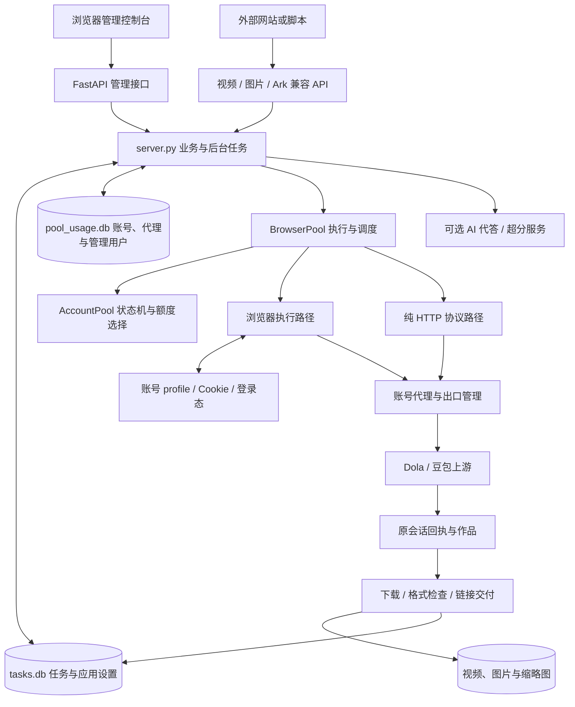
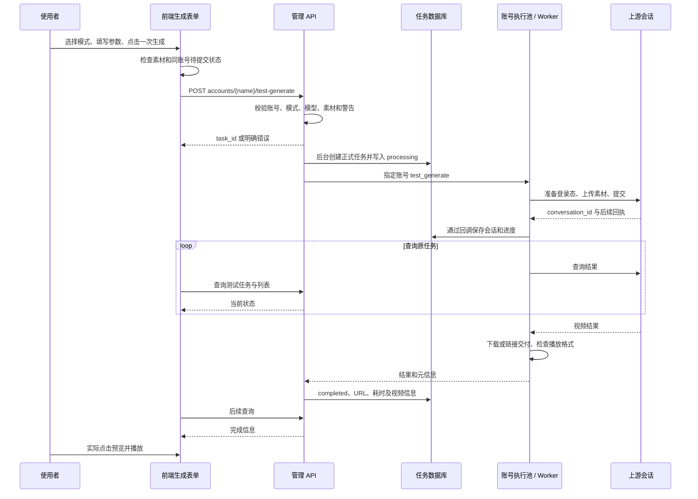
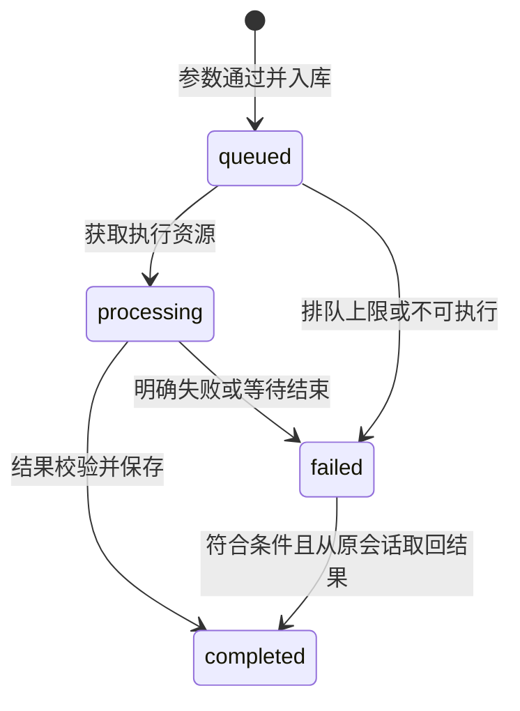

# Dola Studio 完整项目解说

面向产品使用、二次开发、接口接入、部署运维与项目交接的中文说明书。

文档日期：2026-11-25，时区 Asia/Shanghai。源码核对基线：`7212e56e14c8b695e1c51e102ccf224a61ae1814`。仓库：[sailsships/dola-studio](https://github.com/sailsships/dola-studio)，访问需要相应仓库权限。

本文把三类信息分开说明：**当前源码实现、已经发生的真实验收、后续建议**。界面出现一个选项、接口返回成功、视频最终生成并能播放，是不同层次的结果。文中的成功样例均限定于已记录的验收条件。

## 阅读导航

| 阅读目的 | 建议章节 |
| --- | --- |
| 第一次了解项目 | 1—4：定位、能力、架构与目录 |
| 学习日常操作 | 5—9：界面、模式、生成操作、任务与账号 |
| 理解速度、并发和风控反馈 | 10—13：代理、登录、调度与恢复 |
| 接入自己的软件或网站 | 17—22：API 调试、鉴权、视频、图片与兼容协议 |
| 安装、备份和升级 | 23—27：配置、部署、数据维护与排障 |
| 接手开发与核对交付 | 28—33：验收、测试、维护建议、许可与解说稿 |

配套源码附录：[全部路由](reference/API-ROUTES.zh-CN.md)、[环境变量](reference/ENVIRONMENT.zh-CN.md)、[请求及响应模型](reference/DATA-MODELS.zh-CN.md)、[数据表](reference/DATABASE.zh-CN.md)。附录由静态源码提取，不读取线上账号或配置。

## 1. 项目是什么

Dola Studio 是一个管理 Dola、豆包账号、代理与生成任务的 Web 控制台，同时提供供其他网站、脚本和工具调用的生成 API。

它把原本需要逐个登录账号、打开页面、填写提示词、等待结果、下载作品的流程整理成一套统一服务：前台负责操作与展示，后台负责账号选择、会话准备、上游提交、状态查询、结果保存和异常恢复。

视频、图片的生成计算发生在上游服务。本项目的服务器主要承担 HTTP 服务、浏览器自动化、协议交互、文件处理和任务调度。增加本机 GPU 不会直接增加上游生成额度；增加 CPU、内存和带宽可以改善本地执行阶段，但无法保证上游更快出片。

### 1.1 项目主要服务三类使用者

| 使用者 | 主要工作 |
| --- | --- |
| 运营或创作者 | 管理账号、创建视频、观察任务、预览和下载作品 |
| 接入开发者 | 配置地址和 API Key，以统一接口创建及查询任务 |
| 维护人员 | 检查账号状态、代理、并发、日志、数据库、备份和版本 |

这些是使用分工，不等于当前服务已经实现对应的细粒度权限角色。管理权限边界见第 18 章。

### 1.2 名称与版本要分清

| 名称 | 当前含义 |
| --- | --- |
| Dola Studio | 本定制版本的产品与自研贡献署名 |
| 服务端 `APP_VERSION` | 当前源码为 `2.8.3` |
| 前端 manifest 构建标识 | 当前为 `20261125-live-audit-1` |
| 系统字体样式标识 | `20261125-system-type-1`，用于静态资源缓存更新 |
| Git 提交号 | 精确标识仓库内容，排障和回滚时应同时记录 |
| 上游模型版本 | 如 Seedance 2.0 Fast、2.5，与本服务版本无关 |

只报告“2.8.3”不足以精确复现本定制版。排查问题时最好同时记录 Git 提交、前端资源版本、浏览器运行时与实际配置。

## 2. 现有功能与能力边界

### 2.1 功能总览

| 功能 | 实现内容 | 当前验收边界 |
| --- | --- | --- |
| 创作工作台 | 选择账号、聊天或工作模式、模型、时长、比例、提示词与素材 | 两模式各有真实 15 秒成功样例 |
| 任务管理 | 列表、搜索、分页、状态、耗时、提示词、素材回看和结果恢复 | 已验收关键交互；不是所有错误分支都在线覆盖 |
| 视频作品 | 预览、元信息、下载或链接交付、可选超分入口 | 真实播放通过；整文件下载仍存在网络超时记录 |
| 账号管理 | 导入、登录、验证、探活、备注、代理绑定、额度和分组 | 管理交互已验证；部分 Google OAuth 超时仍存在 |
| 代理管理 | 静态、动态会话、提取型节点、检测、轮换和绑定 | 独立测试代理 CRUD 已验收；不能据此证明所有供应商兼容 |
| API 密钥 | 创建、启停、日限、并发、时长白名单和有效期 | 真实写入、查询和鉴权已验收 |
| API 调试 | 可修改连接地址、请求模板、说明、保存导入导出 | 读接口与模板操作已验收；未单独在线生成 API 新任务 |
| AI 代答 | 在生成前追问场景提供有限决策 | 设置与缺配置反馈已验收；外部 AI 服务未验收 |
| 视频超分 | 独立开关、供应商配置、任务和结果 | 默认关闭，隐藏与后端拦截已验收；未调用付费供应商 |
| 豆包生成与生图 | 模型路由、账号类型、视频及图片处理 | 有源码实现，本轮没有豆包账号可做真实生成验收 |
| 更新管理 | 检查、排空任务后交接更新代理 | 检查已验收；自有仓库完整发布流水线尚未建立 |

### 2.2 当前不能据此承诺的内容

项目没有证据支持“所有账号都能生成”“永久避免上游限制”“任意网络环境下载稳定”“30 秒和参考素材全组合均成功”“所有历史测试已通过”等结论。

上游账号权限、额度、地区、会话状态、页面变化和网络链路都会影响结果。本项目能做的是明确失败阶段、限制不必要的重复提交、保存回执，并在条件允许时恢复原任务。

## 3. 整体架构



### 3.1 各层分别负责什么

**前端层**以原生 HTML、CSS、JavaScript 实现管理界面。它读取后台数据，提交管理操作，以轮询同步状态。它不在浏览器标签页内执行上游生成，也不因关闭弹窗就撤回后台任务。

**接口与业务层**集中在 `server.py`：校验参数和权限、创建数据库任务、启动异步执行、把内部结果转换成兼容 API 格式、启动恢复和维护循环。

**账号执行层**主要由 `browser_pool.py` 组织。它结合账号类型、站点、执行模式、可用额度、账号占用和出口状态，调用合适的生成 worker。

**纯状态层**的 `pool.py` 负责账号状态机与调度规则，不能把它与执行浏览器的 `BrowserPool` 混为一谈。

**持久化层**使用 SQLite 和本地文件。数据库任务记录能够跨进程重启保留，浏览器 profile 保存登录上下文；两者缺一不能认为完整备份。

### 3.2 当前不是分布式任务系统

当前后端以单进程 asyncio 服务为中心，阻塞操作通过线程执行，另有浏览器或 Node 子进程。没有内置 Redis/Celery 分布式队列，也没有经过验证的多服务副本协调机制。

直接给 Uvicorn 增加多个 `--workers`，会产生多份内存账号池、锁、恢复循环与后台状态，不能当作安全扩容方案。数据库锁也不能自动解决跨进程浏览器会话竞争。

## 4. 代码目录与职责

### 4.1 主干代码

| 文件或目录 | 职责 |
| --- | --- |
| [`server.py`](../server.py) | FastAPI 入口、请求模型、接口、任务执行、恢复与维护循环 |
| [`config.py`](../config.py) | 环境读取、默认值、超时、额度与兼容开关 |
| [`browser_pool.py`](../browser_pool.py) | 账号执行池、分组、路由、会话与生成调度 |
| [`pool.py`](../pool.py) | 账号状态机、配额和选择策略 |
| [`store.py`](../store.py) | 任务、设置、业务 API Key、统计及恢复字段持久化 |
| [`studio_views.py`](../studio_views.py) | 公开健康信息白名单和管理视图投影 |
| [`user_store.py`](../user_store.py) | 管理用户、密码哈希、登录会话与撤销 |
| [`cred_store.py`](../cred_store.py) | 自动重登所需登录凭据的 Fernet 加密存储 |
| [`proxy_store.py`](../proxy_store.py) | 代理、账号映射、动态会话、节点库存和出口身份 |
| [`browser.py`](../browser.py) | 浏览器上下文、账号锁、Cookie 和基础运行能力 |
| [`sites.py`](../sites.py) | Dola / 豆包识别及模型规格 |

### 4.2 生成、登录与媒体模块

| 模块 | 主要作用 |
| --- | --- |
| `force15_worker.py`、`force15_preparation.py` | Fast 15 秒聊天流程、准备和有限续提 |
| `video_worker_agent.py`、`video_worker_ui.py` | 工作模式与浏览器页面执行、入口、参数、附件和结果处理 |
| `video_worker.py` | 通用浏览器生成与页面结果轮询 |
| `browser_video_params.py` | 模型、比例、时长控件选择及回读 |
| `work_reply.py`、`work_pair.py` | 模式规范化、请求组合约束和历史拼接路径 |
| `pure_api_gen.py`、`pure_signer.py`、`protocol/` | 兼容 HTTP 生成、签名与站点协议封装 |
| `doubao_gen.py`、`doubao_account.py`、`image_gen.py` | 豆包视频、账号能力和图片生成 |
| `login.py`、`login_steps.py`、`google_controls.py` | 登录执行与控件处理 |
| `login_readiness.py`、`login_observation.py`、`page_state_check.py` | 页面与登录就绪判断、观测 |
| `login_concurrency.py`、`window_concurrency.py`、`concurrency.py` | 登录槽位、浏览器窗口槽位与可调并发 |
| `media.py`、`reference_audio.py` | 素材 URL、大小、落盘、音轨和时长校验 |
| `video_probe.py`、`compress.py`、`video_link.py` | 媒体检测、浏览器可播放格式和短链接交付 |
| `completion_receipt.py`、`completion_timeout.py`、`generation_errors.py` | 上游回执、等待边界、结构化错误 |
| `dola_responder.py` | 可选 AI 追问代答 |
| `upscale.py` | 超分供应商与结果处理 |
| `updater.py`、`deploy/`、`docker/` | 更新及历史部署支持，不等于已验收发布流水线 |

### 4.3 前端不是 React/Vue 工程

`web/index.html` 是页面入口，`web/app/` 存放按顺序加载的经典脚本。日常样式或逻辑修改不需要凭空增加一次 `npm build`。

当前 manifest 列出 19 个主脚本，启动脚本最后加载。还存在 `console-sync.js`、品牌、国际化、API 说明和弹窗辅助脚本。具体哪些文件真正执行，应看 `web/index.html` 的脚本引用，再与 manifest 对照。

仓库同时保留部分未带内容标识的旧文件，例如 `runtime.js`、`accounts.js`、`boot.js`。修改同名旧文件不保证页面生效；也不能在没有查依赖前全部删除。

当前关键在用文件包括：

- `web/app/request-client.js`：统一请求。
- `web/app/refresh-engine.71c9bbf1c395.js`：资源刷新调度。
- `web/app/runtime.233eaa892e34.js`：页面、登录和刷新衔接。
- `web/app/accounts.dc44505c44a7.js`：账号操作及生成跟踪。
- `web/app/creation.js`：生成表单、模式与素材限制。
- `web/app/tasks.js`、`web/app/videos.js`：任务和作品。
- `web/app/diagnostics.js`、`web/api-guide.js`：API 调试与说明。
- `web/app/boot.5d8bc51e2c4e.js`：启动及周期任务。

完整顺序见 [`web/app/manifest.json`](../web/app/manifest.json)。

## 5. 七个主要页面怎么使用

### 5.1 创作工作台

用于组织创建视频的操作入口。先确认使用哪个站点和账号，再选择聊天或工作模式、模型、时长、比例与条数，填写提示词，按需要添加参考素材。

模式切换会影响后面的可选项。某些选项被禁用或自动调整，是因为当前模型、账号类型或素材组合不兼容。不要只检查按钮颜色，还应确认最终表单值。

### 5.2 任务列表

任务表展示生成过程，重点字段顺序为：**账号、状态、时长、创建时间、耗时、提示词、参考图**，另有相应的操作入口。

每页 50 条，通过分页继续读取更多记录；这不是整个系统只能存 50 条。搜索和分页会影响当前显示集合，找不到任务时应先清理筛选或按完整任务 ID 检索。

任务详情中的提示词是用户输入的一层；后台还可能保存素材来源补充、参数规范化与有限追问的执行信息。排查内容变化时应沿完整执行链检查。

### 5.3 视频作品

重点字段为：**账号、状态、模型、时长、尺寸、大小**。该页面面向结果使用，任务列表面向执行过程，两者不是重复的同一张表。

预览应实际播放并确认时间推进。拿到一个非空 `video_url`，或 HTTP 头返回 200，都不等于客户端已收到完整可播放文件。

### 5.4 账号管理

用于查看账号分组、可用额度、是否参与调度、登录或验证进度、代理绑定和备注；还承载指定账号测试生成、批量验证和导入等入口。

“验证”“你好探活”“测试生成”的作用不同：前两者检查登录或聊天可用性；测试生成会真正创建作品并消耗上游额度。账号验证成功不保证其具备某个模型或时长的生成权限。

### 5.5 代理管理

管理代理记录、节点、密码、出口检测与轮换，再将代理绑定给账号。保存代理配置只是保存数据；还需要确认服务器能经该代理访问实际使用的上游域名。

编辑时空密码保留原值的行为已针对测试代理验收。查看或导出包含密码的信息时，应把结果按敏感配置处理。

### 5.6 API 密钥

为外部调用方建立独立业务 Key，可设置日限、并发、时长范围与有效期。不同客户应使用不同 Key，便于任务归属、统计、停用和故障定位。

这类 Key 不等于网站管理员的登录会话，也不等于上游账号 Cookie。

### 5.7 API 调试

该页同时承担连接配置、模板说明与调试工具的角色。将示例地址改成实际 Dola Studio 网站地址，填业务 API Key，再按所选接口发送读取或生成请求。

模板是通用的；域名、反向代理前缀、模型、模式和调用方需求应手动核对。页面能列出模型，不说明当前账号池可以执行所有模型。

### 5.8 底部操作区与弹窗

设置、刷新、自动刷新和注销属于全局操作。关闭弹窗统一使用右上角叉号，但这里的“关闭”只是关闭当前视图。

**关弹窗、切换栏目、关闭浏览器标签页，不等于取消已提交的上游生成。** 当前界面不能据一个叉号推断已经完成后台取消。

## 6. 聊天与工作两种模式

### 6.1 用户层面只有两种主模式

| 维度 | 聊天模式 | 工作模式 |
| --- | --- | --- |
| 使用路径 | 聊天会话内的视频能力 | 工作/协作入口的视频流程 |
| 15 秒选项 | 提供；Dola Fast 15 秒会规范化为专用执行路径 | 提供；使用对应工作执行流程 |
| 后端常见值 | `chat`，特定组合变为 `force15` | `work` |
| 账号约束 | 取决于站点、模型和登录态 | 还取决于工作入口、账号类型及工作额度 |
| 浏览器开销 | Fast 15 秒也可能使用完整浏览器 | 通常需要工作会话和浏览器资源 |
| 稳定性证据 | 一条真实 15 秒任务完成并实际播放 | 一条真实 15 秒任务完成并实际播放 |

不存在“聊天必然省资源、工作必然更稳”的固定结论。要比较压力，需要用相同硬件、账号、代理、素材、并发与任务样本分别测量准备耗时、内存峰值、失败阶段及最终出片率。

### 6.2 后台为什么仍有四个执行值

后台兼容 `chat`、`work`、`force15`、`auto`。后两者是兼容和内部执行概念，没有增加两个新的用户主模式。

`work_reply.normalize_execution_mode` 会规范化请求。例如 Dola Seedance 2.0 Fast 的聊天 15 秒组合会进入 `force15` 专用流程。

当前 `force15` 限定 Dola Fast 2.0 兼容模型名、**单条、15 秒**，不是“任意模型任意时长强制成功”的开关。它仍受账号权限、上游回执、页面、网络和实际生成结果约束。

`auto` 用于历史接入兼容，可能受到工作 15 秒开关和旧路径影响。新接入建议明确填写 `execution_mode`，避免服务默认行为与调用方理解不同。

### 6.3 模型、时长与条数约束

| 场景 | 当前界面或请求规则 | 说明 |
| --- | --- | --- |
| Dola Fast 聊天 | 界面 5 / 10 / 15 秒 | 15 秒使用专用路径；5/10 秒的执行后端可不同 |
| Dola Fast 工作 | 界面 5 / 10 / 15 / 30 秒 | 显式工作请求有对应校验；30 秒仍待实际上游验证 |
| Dola 2.5 | 界面提供 5 / 10 / 15 / 30 秒 | 当前 UI 不允许 Dola 2.5 选择工作模式 |
| 豆包 2.0 系列 | 界面通常 5 / 10 / 15 秒 | API 模型范围与 UI 档位不同，需按精确模型检查 |
| 豆包 2.5 | 界面包含 30 秒 | 账号权限与套餐仍须满足 |
| 两条视频 | 仅显式 Dola 工作模式、每条 15 秒的相应组合 | 两个结果不等于一个 30 秒文件 |
| 参考音频 | 聊天 + Dola Fast + 15 秒 | 其它组合拒绝，不应静默丢音频 |

源码注释保留了上游不同时期的能力观察，部分关于 15/30 秒的描述互相矛盾。当前应先看请求校验、模式分发和真实回执，不能把历史注释当作现时能力保证。

### 6.4 豆包账号类型会约束模式

豆包工作类账号在界面锁定工作模式，个人类账号锁定聊天模式。这是账号类型决定的流程约束，不是单纯的视觉偏好。

Dola Cookie 账号的纯 HTTP 路径与 CloakBrowser 路径也不同：普通纯 API Cookie 账号不能直接承担 Dola 工作模式。设置一个 `work` 字段不会自动给账号补齐浏览器或工作能力。

### 6.5 30 秒必须单独理解

代码同时保留原生 30 秒尝试、历史长视频模式与两段拼接兼容逻辑。`DOLA_30S_MODE`、`DOLA_ALLOW_30S_PAIR`、工作路径和模型会影响实际处理。

不要把“下拉框有 30 秒”“两条各 15 秒”“本地拼接为 30 秒”“上游原生单条 30 秒”混为一个能力。验收应核对请求、最终文件数量、每条实测时长、是否发生拼接与实际额度消耗。本轮只真实确认了两种模式的单条 15 秒样例。

## 7. 一次真实生成怎么操作与执行

### 7.1 日常操作步骤

1. 登录管理控制台，确认账号和代理没有正在进行的维护任务。
2. 在账号管理或创作入口选择一个已验证可用、当前闲置的账号。
3. 选择聊天或工作模式，并确认模型、15 秒、比例和条数。
4. 填写提示词；首次排障建议不加参考素材，先证明最小文本生成链路。
5. 点击生成一次，记录返回的完整任务 ID。
6. 在任务列表观察准备、等待上游和结果处理信息，不因窗口关闭或等待较久重复点击。
7. 任务完成后打开作品预览，确认能播放；需要交付时再核对完整下载与文件元信息。

“测试生成”是真实业务动作，具有上游提交和额度消耗。它不等同于测试环境或无消耗模拟。

### 7.2 指定账号按钮的完整执行链



前端主要函数是 `openStudioCreate` → `openTestGen` → `submitTestGen`；后端是 `admin_test_generate` → `_run_test_generate` → `pool.test_generate` → `_generate_effective` → 相应 worker。

指定账号测试会跳过普通选号流程及部分常规调度资格筛选，但仍受真实账号占用、全局并发、执行锁、代理、浏览器资源与结果记账影响。`force: true` 仅表示确认了测试警告，不是绕过上游权限或风控。

### 7.3 哪一步才算成功

| 证据 | 能说明什么 | 还不能说明什么 |
| --- | --- | --- |
| 点击按钮后出现提示 | 前端事件已执行 | 后台是否受理 |
| 返回任务 ID | 请求已进入本地任务流程 | 上游是否接受生成 |
| 保存 conversation_id | 已有可追踪的上游会话 | 会话一定正在计算视频 |
| 上游出现生成卡片或任务 | 进入更明确的生成阶段 | 最终一定成功 |
| 本地任务 completed | 服务按当前规则完成结果处理 | 任意客户端均可完整下载 |
| 实际播放、ffprobe 与完整哈希核对 | 指定文件可用且传输完整 | 长期成功率和所有组合均正常 |

### 7.4 当前默认提示词

[`web/app/creation.js`](../web/app/creation.js) 中 `DEFAULT_TEST_PROMPT` 为：

> 古风玄幻夜景，山崖之巅，月色如银盘，漫天繁星。少年斜躺在青草地上，嘴里叼着一根青草，轻轻咀嚼，神色淡然。他抬起白皙手掌挡在眼前，目光透过指缝望向空中巨大银月，氛围静谧悠远，柔和清冷月光，氛围感拉满，构图稳定，人物面部一致，运镜缓慢推拉，写实漫剧质感，光影统一，细节细腻，无闪烁

这是新建表单的默认输入，不代表后台所有请求都会强制替换为该文本。API 调用可提交自己的提示词。

## 8. 任务生命周期与状态

### 8.1 主要状态



最后一条是受条件限制的后台取回，不表示任意失败都会自动变成功。数据库中还可能存在历史或特殊显示状态，如“风控”，调用方应保留原始错误并兼容非预期状态。

### 8.2 不同维度不要混用

| 状态维度 | 典型内容 |
| --- | --- |
| 主任务 | queued / processing / completed / failed |
| 结果取回 | watching / recovered / gave_up 等恢复字段 |
| 超分 | queued / processing / completed / failed / skipped |
| 新增账号作业 | 排队、运行、等待回答、失败、取消等作业状态 |
| 账号分组 | 满额、半额、冷却、生成中、风控等 |

一条原片已经完成的任务，可以同时处于超分处理中。账号显示“生成中”是账号占用情况，不等于所有关联任务字段都已到达终态。

### 8.3 关键持久化字段

| 字段类别 | 作用 |
| --- | --- |
| `id`、model、prompt、ratio、duration | 请求身份和主要参数 |
| `execution_mode`、`video_count` | 实际执行路径与结果条数要求 |
| `account`、`conversation_id` | 关联账号和原上游会话 |
| `created_at`、`started_at`、`finished_at` | 区分等待时间、执行时间与完成时间 |
| `deadline_at`、`last_poll_at` | 超时和停滞判断 |
| `failure_code`、error、attempt history | 失败分类与尝试追踪 |
| reference、thumbnail、source、supplement | 素材与提示词补充 |
| `api_key_hash`、`api_key_name` | 外部任务归属与客户统计 |
| URL、尺寸、大小、实测时长、video model | 作品交付、显示及链接续签 |
| recovery 与 upscale 字段 | 恢复和后处理状态 |

字段会通过兼容迁移逐步补齐，不能只看最初的 `CREATE TABLE tasks` 判断当前完整 schema。实际表结构还要结合 `ALTER TABLE` 迁移与实例数据库核对。

### 8.4 预计耗时不是倒计时承诺

预计耗时结合排队量、并发、档位兜底与近期开片样本。上游负载、代理准备、账号切换和下载会使实际耗时变化。

API 的 `progress` 是扩展进度结构，不应自行解释为固定 0—100 的完成百分比。前端每秒更新时间显示，也不说明每秒有一次上游生成进展。

## 9. 账号、登录态、分组和额度

### 9.1 同一个账号有多类状态

账号名只是本地管理标识。其可用性同时依赖：站点、Cookie、浏览器 profile、最近登录验证、账号套餐或权限、日额度或工作额度、当前占用、代理与上游返回。

因此“导入成功”“账号存在”“验证通过”“有剩余额度”“能生成 15 秒”是不同判断。一个账号可以登录成功但不具备请求模型权限，也可能额度充足但出口不可用。

### 9.2 管理页面的分组含义

| 分组 | 含义 |
| --- | --- |
| 满额 | 根据本地记录有较完整的可用额度；不是上游永久保证 |
| 半额 | 剩余部分额度，需要按模型和时长判断是否够用 |
| 冷却 | 今日限制、余额、暂停或其他暂不可派发条件 |
| 生成中 | 账号已被生成执行占用 |
| 登录处理中 | 正在检查或恢复登录，等待最终结果 |
| 风控 | 登录态失效、上游限制或相应风险标记，需要看原因 |
| 待激活 | 尚未完成首次激活或探测 |
| 异常 | 执行异常、连续失败或 profile 等问题 |
| 加号中 / 加号失败 | 新增账号作业投影，未必已成为完整账号 |

底层 `AccountState` 还存在 `standby`、`healthy`、`cooldown`、`expired`、`unsigned`、`checking` 等状态。这套状态机与上述运营分组不是一一对应关系。

### 9.3 “有效账号”不等于当前能立即派发的账号

统计中的有效组可能包含“冷却”和“生成中”。因此有效账号数不应直接乘以某个速度计算立即可执行产能。

调度还要检查当前模式、站点、权限、余额、同账号占用、出口退避与窗口槽位。

### 9.4 额度有多个口径

本地有模型成本、时长成本、每日限制与启派门槛；上游也可能返回实际余额或周额度。前者是调度估计，后者是更直接的运行证据。

Dola 工作路径有单独的工作额度处理，不能直接套用聊天的每日点数。豆包另有套餐与本地派发上限；当前源码 `DOUBAO_ALLOW_PAID` 默认读取值为 `1`，符合相应场景时可能自动确认使用付费额度。部署前应明确该配置是否符合业务预期。

每日刷新时区由 `DOLA_LIMIT_RESET_TZ` 与 `DOLA_LIMIT_RESET_HOUR` 控制，源码默认 UTC 0 点，即北京时间 8 点。本地计数重置不等于上游真实余额一定在相同时间恢复。

### 9.5 账号改名与删除

改名涉及 profile、绑定、元信息、用量与登录凭据，不应只手动重命名一个目录。界面会拦截正在生成的账号改名。

删除和批量清理可能影响会话及后续恢复，操作前要核对关联任务。删除本地任务记录也不等同于取消上游生成，不能作为停止扣额度的方法。

## 10. 代理与出口如何工作

### 10.1 三种代理模式

| 模式 | 用途 | 需要确认的事项 |
| --- | --- | --- |
| `static` | 一个固定地址对应固定出口 | 地址、认证、实际出口与稳定性 |
| `dynamic` | 同一网关通过会话选择器获取不同出口 | 用户名模板、sticky session、供应商 TTL |
| `extract` | 从提取接口或手工节点库存中取得可用节点 | 提取结果格式、有效期、可用节点和补充速度 |

静态出口身份通常基于协议、host 和 port；动态网关还包含会话标识。这样多个账号共用网关时，可以按各自会话区分出口。

但本地会话不同不保证供应商一定分配不同公网 IP；仍要用实际出口探测核验。

### 10.2 代理选择顺序

执行通常优先使用账号绑定的代理；未绑定时回落到全局 `DOLA_PROXY`。源码全局默认值是 `http://127.0.0.1:7890`，若服务器上没有对应服务，这个默认值不会自动变成可用代理。

部分素材上传还受 `DOLA_UPLOAD_PROXY_BYPASS` 和直连回退配置影响，因此“给账号绑了代理”不代表所有请求都经过同一出口。

### 10.3 为什么访问首页正常仍可能生成失败

页面、登录、聊天、素材上传、任务轮询和媒体 CDN 可能使用不同域名与连接。代理通过一次首页检测，只证明该检测目标当时可达。

排查应按阶段分别确认：代理连接 → 站点页面 → 登录检查 → 素材上传 → 提交回执 → 会话轮询 → 视频 CDN。不要在素材 CDN 失败时只反复验证首页。

### 10.4 轮换、预检与退避

代码包含派发前出口检查、不可达时的有限轮换、账号级冷却和出口级递增退避。它们的目的是减少反复使用当前不可用路径，不保证修改出口就能解决账号权限或上游限制。

上游返回 `710022002` 时，应先保存原始错误、任务和会话状态，再区分已提交或未提交、账号级或出口级信号。不要把“换一个账号成功”解释成全池风险已经清除。

## 11. 批量登录为什么慢，哪些地方可以优化

### 11.1 一次登录包含多个等待阶段

登录可能包括等待槽位、启动浏览器、连接代理、加载页面、身份供应商跳转、密码或二次验证、返回业务站点、等待页面状态稳定和保存会话。

“检查页面状态”是上述链路中的阶段提示，不能单凭文字判断根因。它可能在等待登录回跳，也可能遇到网络失败、错误页面、验证控件或页面未就绪，需要结合当前页面与阶段日志确认。

### 11.2 登录并发独立于生成并发

`DOLA_LOGIN_CONCURRENCY` 支持 1—4。未显式设置时，Linux 上按 `/proc/meminfo` 判断：总内存至少 3 GiB 且可用内存至少 1.5 GiB 时默认 2，否则默认 1；无法读取时也回落到 1。

这是保守的默认策略，不是证明 4 并发一定更快。内存不足、同出口拥堵或 OAuth 等待时，提高并发可能使每个任务更慢，并占用更多浏览器。

### 11.3 当前已经做的修复

自动重登失败后的冷却起点改为本次尝试**结束时刻**，避免一个耗时很久的失败刚结束，就因为早先计时已过而立刻再次排队。

真实日志曾观察到失败后约 191 秒才再次尝试，说明冷却逻辑生效。原账号的 Google OAuth 超时仍存在，不能把“减少重复重登占用”写成“已经解决所有登录超时”。

### 11.4 建议的性能优化顺序

1. 分别统计槽位等待、浏览器启动、页面连接、OAuth 与状态检查耗时。
2. 先处理长期失败的账号和代理，减少无效任务占用。
3. 确认 profile 可写、浏览器版本匹配、磁盘和内存有余量。
4. 以 1 为基线，再在相同条件下测 2，并比较完成率与总耗时。
5. 保持原始失败记录；不要靠缩短超时让失败更快出现来伪装提速。

本轮尚未完成批量新增账号全部成功的端到端验收。

## 12. 调度、并发与资源压力

### 12.1 并发至少分五层

| 层级 | 作用 | 常见配置或位置 |
| --- | --- | --- |
| 全局生成并发 | 限制同时执行的生成任务 | `DOLA_MAX_CONCURRENCY`、运行期并发设置 |
| 客户 Key 并发 | 限制某个接入方同时执行的任务 | API Key 的 `concurrency_limit` |
| 账号占用 | 避免同一账号竞争会话与额度 | 执行池账号锁与占用状态 |
| 浏览器窗口槽位 | 限制相关浏览器流程同时占用 | `DOLA_WORK_15S_CONCURRENCY` 与窗口设置 |
| 登录槽位 | 限制新增、导入和自动重登 | `DOLA_LOGIN_CONCURRENCY` |

此外还有待处理总数、线程池、出口退避与可打开账号数等约束。改变一处并发不代表其它资源限制同时改变。

### 12.2 默认“不限”不等于没有瓶颈

`DOLA_MAX_CONCURRENCY=0` 表示该全局限制不设固定上限。真正吞吐仍可能被可用账号、浏览器槽位、上游排队、内存、线程、代理和带宽限制。

`DOLA_MAX_PENDING_TASKS` 默认 100，统计待处理任务。该限制与运行中任务并发不同：可以有任务已受理但尚未取得执行资源。

### 12.3 在线调窗口数的语义

`WindowSlots` 维护 active、waiting 和动态 limit。修改上限后会通知等待者；降低上限不会自动杀掉已经持有槽位的流程，需要等其自然释放。

因此看到 active 暂时大于新上限，不一定是设置未生效。应观察已有任务结束后是否按新限制继续派发。

### 12.4 “提交窗口”可能指什么

在资源设置语境中，窗口通常指执行提交的浏览器实例或槽位，不是视频播放时长，也不是必须在桌面上看见的弹窗。

在日志或代码中，“提交时间窗口”也可能指允许尝试的时间区间。应根据上下文区分浏览器数量、提交间隔和任务截止时间，不能仅凭“窗口”两个字调整参数。

### 12.5 评估聊天与工作压力的方法

建议按同一组基准分别记录：任务准备秒数、上游等待秒数、结果下载秒数、浏览器进程峰值、内存峰值、同出口占用与最终成功结果。纯 HTTP 路径与浏览器路径应分别统计。

如果主要耗时在上游排队，加服务器 CPU 帮助有限；如果主要耗时在浏览器启动且发生内存换页，应先限制并发和检查运行环境。

## 13. 超时、结果未知与任务恢复

### 13.1 项目存在多类超时

| 等待类型 | 相关配置示例 | 关注点 |
| --- | --- | --- |
| 提交前准备 | `DOLA_PREPARE_TIMEOUT` | 导航、登录、上传和参数选择 |
| 普通出片等待 | `DOLA_VIDEO_TIMEOUT` | 某条执行路径的基础等待 |
| 带参考图等待 | `DOLA_REFERENCE_VIDEO_TIMEOUT` | 上传及生成更复杂 |
| 纯 API 等待 | `DOLA_PURE_TIMEOUT` 及上限 | 与浏览器路径不同 |
| 工作等待 | `DOLA_WORK_15S_TIMEOUT` | 工作流程生成窗口 |
| 换号或总执行约束 | `DOLA_TASK_DEADLINE`、`DOLA_WORK_RETRY_SECONDS` | 不能只盯单次轮询 |
| 本地排队上限 | `DOLA_MAX_QUEUE_WAIT_SECONDS` | 尚无上游会话的排队任务 |
| 上游预计等待扩展 | `DOLA_WAIT_FACTOR`、margin、hard max | 根据上游预计时间调整 |
| 后台结果取回 | `DOLA_RECOVER_TIMEOUT_SECONDS` | 终态后继续查询原会话 |
| 停滞巡检 | `DOLA_STALE_TASK_SECONDS`、watchdog interval | 检查缺乏进度的本地任务 |

`DOLA_VIDEO_TIMEOUT=300` 不能解释为“任何请求固定五分钟失败”。具体路径还会叠加总截止、工作或素材等待、上游预计时间与恢复规则。

### 13.2 最关键的边界：是否已经提交上游

提交前明确失败，通常可以在规则允许时修复准备条件或换号。已经提交并保存会话后，客户端超时不说明上游停止执行。

结果未知时盲目重提可能产生两条实际生成。当前代码对会话保存、发送确认和错误分类做了处理，但不能据此宣称任何故障下都实现了严格的“恰好一次”。

### 13.3 原会话取回

满足条件的超时任务可以进入恢复观察。`_recover_loop` 查询原账号、原会话的结果，**不通过这个循环重新提交生成**。

如果后来找到作品，系统可以下载并将任务更新为完成；超过恢复窗口仍没有结果，则结束观察。账号会话丢失、代理不可用或上游会话失效都会影响取回。

### 13.4 服务重启时恢复什么

启动阶段会检查未完成的持久任务、已有会话、可继续派发的排队任务、恢复观察与超分任务，并启动维护循环。

内存中的新增账号作业、临时测试进度映射和前端待提交对象，不等于数据库任务。重启后弹窗进度不一定原样恢复，应以持久任务列表及原会话记录核验。

### 13.5 为什么失败任务后来变成完成

可能是本地等待先结束，而上游随后出片，被后台取回。应查看 recovery 字段、会话、最终文件和时间，不能立刻认定数据库状态错乱。

## 14. 前端为什么采用后台刷新

### 14.1 当前是轮询，不是 WebSocket

启动脚本每 2 秒触发一次 `liveRefreshTick` 检查。账号、任务、工作台属于较频繁刷新栏目；其它栏目通常约 10 秒检查一次。是否真正发请求还受自动刷新开关、可见性、网络、在飞请求与失败退避限制。

本地计时显示每秒更新；版本检查约每分钟，更新徽标检查约每五分钟。这些定时器职责不同，不能合并理解为整页频繁重载。

### 14.2 三个层次分别解决什么

| 层 | 主要机制 | 解决的问题 |
| --- | --- | --- |
| `StudioHttp` | 相同 GET 在飞合并，统一错误与登录处理 | 多组件重复读、非 JSON 错误、会话失效 |
| `StudioRefresh` | 按资源排程、一次尾随读取、2—30 秒失败退避 | 重叠刷新、切栏串数据、失败后过密请求 |
| `ConsoleSync` | 按稳定行 key 更新、相同快照跳过、保留交互状态 | 菜单闪退、筛选重置、DOM 重建和视觉闪烁 |

写操作不因为这个读取调度器而自动重试。尤其生成、删除、导入等动作不能套用“GET 失败就再读”的方式。

### 14.3 后台变化怎么同步到前台

后台数据返回后，先比较快照；没有变化时尽量跳过重绘，有变化时更新对应内容。稳定的筛选、搜索和展开状态应保留。

不代表任何数据都永远不动。例如任务从处理中到完成，状态、耗时、作品入口就应该更新；不相关的固定栏目不应因一次定时读取闪现或消失。

### 14.4 生成后列表为什么现在能更快响应

前端点击时建立本地 `pendingGenerations`，立即显示提交中，防止同账号重复操作；拿到任务 ID 后启动跟踪，并主动同步任务、账号等视图。

这能减少“按钮已经点了，列表却很久没变化”的感受，但不能把本地乐观状态当成已生成。失败时仍需回退并显示后端错误。

手动刷新按钮属于一次真实点击，可能触发菜单的外部点击关闭；这与无人操作时后台刷新把菜单重建丢失，是两个问题。验收已区分两者。

更多实现见 [刷新架构说明](REFRESH-ARCHITECTURE.md)。

## 15. 参考图、音频与提示词处理

### 15.1 素材限制

| 素材 | 当前规则 | 依据 |
| --- | --- | --- |
| 图片 | JPG / PNG / WebP，界面最多 30 张 | `creation.js`，后端数量可配置 |
| 单张图片 | 默认最多 20 MiB | `DOLA_REFERENCE_IMAGE_MAX_BYTES` |
| 图片总量 | 默认 60 MiB，另有路径内实际校验 | `DOLA_REFERENCE_TOTAL_MAX_BYTES` |
| 音频 | MP3 / WAV / M4A / FLAC / OGG，最多 3 个 | `reference_audio.py` |
| 单个音频 | 最多 20 MiB，90 秒以内，必须有有效音轨 | 解码及 ffprobe 校验 |
| 表单总素材 | 前端按图片与音频合计 60 MiB 检查 | 前端规则不替代后端各阶段校验 |
| 参考视频 | 当前 multipart 路径明确拒绝 | 返回 422，不应误当作已支持视频参考 |

`MiB` 是 1024×1024 字节。URL、data URL、表单文件的传输与落盘阶段不同，不能把一个限制概括成所有路径唯一的限制。

### 15.2 图片为什么先落盘

内联 base64 会显著增加请求体和数据库体积。当前视频受理流程会把 data URL 素材落盘，再将文件引用写入任务，避免几 MB 的 base64 长期堆在任务表里。

落盘目录由 `DOLA_REFERENCE_FILE_DIR` 指定。任务走到终态会清理相应原素材，并按配置保留缩略图用于回看。因此任务详情能看见缩略图，不代表服务器仍保存完整原图，可供原样重跑。

### 15.3 URL 校验不等于允许读取任意服务器资源

素材处理包含 URL、下载、大小和媒体格式校验。外部接入应提供服务端实际可达的素材，或采用受支持的内联/文件方式。

本说明没有把素材读取路径认定为经过完整安全审计。若要开放给不可信多租户，需进一步验证 DNS、重定向、私网地址与下载限制的实际行为。

### 15.4 提示词分几层

1. 用户输入或 API 的 `prompt`。
2. 模型、比例、时长等生成参数。
3. 可配置的参考图来源补充文本。
4. 特定路径收到追问后的有限确认或续提。

这些层应分别追踪。当前参考图请求未显式写 `reference_source` 时，默认配置是 `ai_generated`，会在相应路径添加 AI 素材说明；纯文字请求不因此自动声称有参考图。

如果没有依据声明素材由 AI 生成，可对业务 API 显式传 `reference_source: "unspecified"`；也可按实际业务修改默认配置。不能把来源说明当成提高成功率的固定万能提示词。

Fast 15 秒续提已改为按真实附件构造文本，不再在无图时声称有图，也不凭空编造图片来源。源码里存在一个历史声明常量，并不说明它当前一定进入请求；应查实际引用与运行路径。

## 16. AI 代答与视频超分

### 16.1 AI 代答的实际作用

它服务于**尚未开始生成、上游提出追问**的场景。例如上游要求补充信息或确认，规则无法直接判定时，可以让配置的 AI 服务辅助决定回复、等待、停止或换号。

它不是面向访客的通用客服，也不是替代 Seedance 的生成模型。不能给账号增加真实会员权限、凭空恢复余额，或保证消除上游拒绝。

配置包含启用开关、兼容服务地址、API Key 与模型。地址、Key、模型齐全才算可用配置；开关与配置完整性是两个条件。

当前模块限制单次 AI 等待约 25 秒，输出长度上限 200 字符，并限制决策及换号次数。决策动作包括 `reply`、`switch_account`、`wait`、`stop`，不是允许任意无限对话。

外部 AI 请求会把其决策所需上下文发送给所配置服务。具体上下文内容应以构造请求的源码为准；配置时要确认服务地址和业务数据使用要求。本轮仅验证设置保存及未配置反馈，没有验证外部供应商调用。

### 16.2 超分为什么默认关闭

超分是成片后的独立处理步骤，可能调用外部服务并产生额外耗时或费用。当前默认关闭；关闭时任务与视频页面隐藏相应按钮，后端也会拦截相关调用并返回 409。

这不是单纯把按钮做成不可见。隐藏入口与服务端限制都需要保持，避免旧页面或外部调用仍然提交超分。

### 16.3 超分服务与结果

当前 provider 支持 `fal`、`open` 和 `custom`，分别有对应密钥、地址或请求模板。超分并发、等待与轮询间隔可单独配置。

API 请求 `resolution: "1080p"`、`"2k"`、`"4k"` 会参与后处理计划，不等于上游模型原生生成该尺寸。开关关闭、配置不足或自动策略不满足时，可能记录 `skipped` 和说明，而不是自动变高清。

原始视频与高清结果地址应区分保存。查看 `video_url_hd`、`resolution`、`upscale_note`，并检查最终文件尺寸；不能仅凭请求里的分辨率认定结果达标。

## 17. API 调试页怎样接自己的网站

### 17.1 需要填写哪些信息

| 项目 | 示例 | 说明 |
| --- | --- | --- |
| 服务地址 | `https://studio.example.com` | 指向本项目服务，不是上游网站地址 |
| 业务 API Key | 由本站密钥管理创建 | 以 Bearer 方式发送，不使用管理员 token |
| 模型 | `seedance-2.0-fast` | 先检查注册名，再确认账号池能力 |
| 执行模式 | `chat` 或 `work` | 新接入建议明确指定 |
| 时长 | `15` | 数值秒数，不是字符串“15s” |
| 比例 | `16:9` | 与像素分辨率不同 |
| 提示词 | 正常 UTF-8 文本 | 长度和编码会校验 |

如果反向代理额外加了前缀，要以实际转发规则决定 URL。不要机械地给每个地址追加两次 `/v1`。

### 17.2 推荐接入顺序

1. 读取 `/health`，确认服务可达。
2. 读取 `/v1/models`，检查路由和模型注册。
3. 用业务 Key 查询一个不存在的任务：通常 404 表示进入查询逻辑，401 表示鉴权未通过。但在匿名开发分支中不能仅凭 404 证明 Key 有效。
4. 在明确允许真实生成的条件下，提交一次最小文本任务，保存任务 ID。
5. 使用相同 Key 轮询任务，并确认最终作品。
6. 最后再加参考图、音频或高清后处理，每次只增加一个变量。

### 17.3 模板的保存、导出与敏感信息

模板应便于更换域名、模型和参数。已验收的配置导出不包含业务密钥，注销也会清除 API 调试密钥。

不要因此推断浏览器全部状态都可公开。实际粘贴的请求、截图、开发者工具网络面板和自定义模板仍可能含提示词、素材地址或认证头，分享前要检查。

## 18. 三类身份、鉴权和访问边界

### 18.1 三类凭据不能混用

| 身份 | 凭据 | 用途 |
| --- | --- | --- |
| 网站管理员 | 登录后得到的会话 token，通过 `X-Admin-Key` 发送 | 管理账号、代理、设置、任务和用户 |
| 外部业务调用方 | 业务 API Key，通过 `Authorization: Bearer ...` 发送 | 创建、查询自己的业务任务 |
| 上游账号 | Cookie、profile、登录凭据 | 由后台访问 Dola 或豆包 |

GitHub SSH Key 是第四种独立用途：仅用于 Git 仓库身份认证，不会自动提供网站或上游账号权限。

### 18.2 管理员登录与注销

`POST /api/admin/login` 使用用户名、密码，成功后得到管理会话。会话有效期当前为七天；服务重启后可从数据库恢复有效会话。

密码采用 PBKDF2-SHA256 与随机盐存储；持久会话保存 token 的哈希。注销会调用 `POST /api/admin/logout` 撤销当前服务端会话，不再只是清除页面状态；其它有效会话不因此一起退出。

首次创建新管理数据库时，源码会补种初始 owner：`admin / admin123`。这是仓库内的初始化默认值，不代表当前线上密码。新部署应先仅本机访问并立即改为自有密码，再开放访问。

`config.py` 的 `DOLA_ADMIN_KEY` 和部分启动注释保留历史含义；**当前 `_admin_auth` 要求登录会话，并不是填写这个历史环境值即可免登录**。

### 18.3 业务 Key 的匿名开发分支

当前 `_auth` 在“环境 Key 列表为空，且数据库没有启用的 Key”时，进入匿名开发模式。

因此关闭最后一个数据库 Key，不能在所有配置下简单理解为关闭了全部业务 API；也可能进入无 Key 的匿名分支。生产环境应明确配置策略，例如保留受控环境 Key，并在未来版本把“允许匿名”做成显式开关。

这是当前源码行为说明，不是本文已修改该逻辑。要验证禁用是否有效，必须在当时的完整 Key 配置下实际请求确认。

### 18.4 任务归属

视频查询和 `/content` 处理器用当前客户的 `api_key_hash` 查询任务。无权读取的任务通常表现为 404，避免直接列出其它客户任务。

任务通过哪个 Key 创建，就应使用对应身份查询。指定账号的管理测试任务与某个外部业务 Key 并非天然同一归属；不能拿任意业务 Key 查询管理测试 ID，再把 404 当成任务丢失。

### 18.5 媒体访问边界

任务查询需要鉴权，不代表所有作品文件 URL 都鉴权。当前 `/videos`、`/thumbs` 是静态挂载，`/v/{name}` 是媒体短链处理入口。

拿到可用媒体地址的人，在没有额外网关限制的部署中可能直接访问。**私有 GitHub 仓库不等于部署网站上的视频私有。** 如果作品需要严格私有交付，应另外设计受控下载、签名 URL、有效期和网关策略。

`/v1/videos/{id}/content` 有任务归属检查，但不能用它的鉴权行为推断静态地址也采用相同规则。

### 18.6 角色与数据存储的真实边界

`owner` 对应的账号有禁止删除、禁用、改名等保护。但当前用户管理等接口主要调用通用 `_admin_auth`，不能把已有角色字段描述成完整 RBAC 或严格的多租户隔离。

更新安装与更新取消另有 `_require_owner` 校验，要求 owner 会话；检查版本与启动安装的权限也不能混为一谈。

不同数据的保护方式也不同：

- 管理员密码是加盐哈希，登录会话以哈希持久化。
- `creds.json` 用 Fernet 加密，密钥来自 `DOLA_CRED_KEY` 或本地 `cred.key`；文件权限设置是尽力执行。
- API Key 表存在可读取的 Key 明文，任务归属字段使用哈希；不能称全部 Key 均单向哈希存储。
- 浏览器 profile、Cookie 和代理配置应按敏感运行数据处理，不能统称已全量加密。

备份加密凭据时还要保留匹配密钥，且应与数据分开保护；丢失密钥不能靠源码重新生成同一把密钥恢复。

### 18.7 公开健康接口实际返回什么

`/health` 使用 `studio_views.public_health` 的白名单投影，公开服务版本、有限计数、队列和存储等统计，不返回完整账号、代理、Cookie、密码或 token。

它可以帮助确认服务活着与队列规模，但不是完整内部诊断，也不会实际为每个账号生成一次视频。返回 `ok: true` 不等于所有上游依赖正常。

`/v1/models` 当前处理器也没有直接鉴权调用，是公开的模型目录。带 Bearer 访问成功不能反推出该接口强制要求 Bearer。

## 19. 视频 API 完整说明

### 19.1 核心路由

| 方法与路径 | 用途 | 当前成功响应特点 |
| --- | --- | --- |
| `POST /v1/videos/generations` | 创建异步视频任务 | 返回任务对象；当前处理器默认 HTTP 200 |
| `POST /v1/videos` | 创建视频的兼容别名 | 同一业务流程，装饰器指定 HTTP 202 |
| `GET /v1/videos/{task_id}` | 查询同身份任务 | 返回状态与作品信息 |
| `GET /v1/videos/{task_id}/content` | 按任务身份获取内容 | 未就绪 409；可重定向或读取远程内容 |
| `GET /v1/models` | 注册模型目录 | OpenAI 风格列表，当前公开 |

创建接口是“异步完成业务”，不意味着每个入口的 HTTP 状态码都固定为 202。客户端应按实际成功响应读取 ID，而不是只接受一种成功码。

### 19.2 推荐请求结构

```json
{
  "model": "seedance-2.0-fast",
  "execution_mode": "chat",
  "prompt": "清晨湖面，远山与薄雾，固定机位，画面稳定，写实自然风景。",
  "duration": 15,
  "ratio": "16:9",
  "video_count": 1,
  "reference_source": "unspecified"
}
```

上例是待调用模板，不表示本文已向线上再次提交。把 `chat` 改成 `work` 后应重新核对账号、模型、浏览器和额度条件。

### 19.3 字段逐项解释

| 字段 | 作用与注意事项 |
| --- | --- |
| `model` | 默认 `seedance-2.0-fast`，建议显式填写受支持注册名 |
| `prompt` | 必填非空字符串，默认上限 20,000 字符，附加说明也参与提交上限 |
| `execution_mode` | `chat` / `work`；兼容 `force15` / `auto` |
| `duration` | 秒数；优先级高于两个别名 |
| `seconds` | 时长别名，优先级第二 |
| `duration_seconds` | 时长别名，优先级第三 |
| `ratio` | 如 `16:9`、`9:16`；兼容层还认其它比例，需以校验为准 |
| `size` | 尺寸兼容字段，可能用于比例解析；不是原生输出尺寸保证 |
| `video_count` | 1 或 2，2 仅允许相应工作 15 秒组合 |
| `reference_images` | 图片 URL 或受支持 data URL 列表 |
| `reference_audio` | 参考音频列表，只允许相应 Fast 15 秒聊天组合 |
| `reference_source` | `unspecified` / `ai_generated`，决定是否附加来源说明 |
| `resolution` | 后处理分辨率请求，受超分设置限制 |
| `image_url`、`image`、`input_image`、`input_images` | 历史接入的参考图兼容字段 |

时长字段不应同时填不同值。如果都填，当前优先 `duration` → `seconds` → `duration_seconds`；缺省时又受模式默认影响。

Pydantic 范围 4—30 秒不表示每个模型、模式都允许其中每个整数。跨字段校验、API Key 白名单和上游能力会继续限制。

### 19.4 创建示例：POSIX Shell

先在执行环境设置实际的 `DOLA_BASE_URL` 和 `DOLA_API_KEY`，不要把真实 Key 写进共享示例文件。将上面的 JSON 保存为 UTF-8 的 `request.json`，然后执行一次：

```sh
curl --fail-with-body --silent --show-error \
  --request POST "${DOLA_BASE_URL%/}/v1/videos/generations" \
  --header "Authorization: Bearer ${DOLA_API_KEY}" \
  --header "Content-Type: application/json; charset=utf-8" \
  --data-binary @request.json
```

输出示意如下，实际会包含相应字段值：

```json
{
  "id": "video_example_only",
  "status": "queued",
  "model": "seedance-2.0-fast",
  "prompt": "清晨湖面，远山与薄雾，固定机位，画面稳定，写实自然风景。",
  "video_url": null,
  "progress": {}
}
```

收到 ID 后先保存。若提交请求网络超时且没有收到 ID，先由管理端按时间、调用方和提示词核查是否已入库，不要立即循环 POST。

### 19.5 查询示例

把实际 ID 放入 `DOLA_TASK_ID` 后反复读取：

```sh
curl --fail-with-body --silent --show-error \
  "${DOLA_BASE_URL%/}/v1/videos/${DOLA_TASK_ID}" \
  --header "Authorization: Bearer ${DOLA_API_KEY}"
```

`queued` 和 `processing` 表示继续等待；`completed` 时检查 `video_url` 和可能存在的 `videos`；`failed` 时保存 `error` 与任务 ID 进行诊断。

调用方本地停止轮询不等于服务端任务取消。等待上限应由自己的业务要求决定，并保留 ID 以便稍后继续查询。

### 19.6 Python 完整调用示例

下面示例使用项目已经依赖的 `requests`，**只创建一次**。它会立即把 ID 保存到本地；再次启动时有 ID 就继续查询。该脚本只管理一个示例任务，不是生产队列客户端。

```python
import json
import os
from pathlib import Path
import time

import requests

base_url = os.environ["DOLA_BASE_URL"].rstrip("/")
api_key = os.environ["DOLA_API_KEY"]
state_file = Path("video-task-state.json")

payload = {
    "model": "seedance-2.0-fast",
    "execution_mode": "chat",
    "prompt": "清晨湖面，远山与薄雾，固定机位，画面稳定，写实自然风景。",
    "duration": 15,
    "ratio": "16:9",
    "video_count": 1,
    "reference_source": "unspecified",
}

with requests.Session() as session:
    session.headers.update({"Authorization": f"Bearer {api_key}"})
    if state_file.exists():
        saved = json.loads(state_file.read_text(encoding="utf-8"))
        if saved["base_url"] != base_url:
            raise RuntimeError("本地记录属于另一个服务地址，请先核对任务归属")
        task_id = saved["id"]
    else:
        try:
            response = session.post(
                f"{base_url}/v1/videos/generations",
                json=payload,
                timeout=(10, 120),
            )
            response.raise_for_status()
            task_id = response.json()["id"]
        except (requests.RequestException, ValueError, KeyError):
            # 无 ID 时可能已经入库；先核查后台，禁止自动重发 POST。
            print("未取得可持久化的任务 ID，请先核查管理端，本次未自动重试提交。")
            raise
        state_file.write_text(
            json.dumps({"base_url": base_url, "id": task_id}, ensure_ascii=False),
            encoding="utf-8",
        )

    print("task_id:", task_id)
    stop_at = time.monotonic() + 3600
    read_failures = 0
    while time.monotonic() < stop_at:
        try:
            response = session.get(
                f"{base_url}/v1/videos/{task_id}", timeout=(10, 60)
            )
            response.raise_for_status()
            result = response.json()
        except requests.HTTPError as error:
            if error.response is not None and error.response.status_code in (401, 403, 404):
                raise  # 先解决凭据或任务归属问题。
            read_failures += 1
            if read_failures >= 3:
                raise
            time.sleep(10)
            continue
        except (requests.RequestException, ValueError):
            read_failures += 1
            if read_failures >= 3:
                raise
            time.sleep(10)
            continue

        read_failures = 0
        status = result.get("status")
        print("status:", status)
        if status == "completed":
            print(json.dumps({
                "video_url": result.get("video_url"),
                "videos": result.get("videos"),
                "video_url_hd": result.get("video_url_hd"),
            }, ensure_ascii=False, indent=2))
            break
        if status == "failed":
            raise RuntimeError(f"任务失败，保留 {task_id} 供排查：{result.get('error')}")
        if status not in ("queued", "processing"):
            raise RuntimeError(f"未识别状态 {status!r}，请核对任务，不自动重提")
        time.sleep(10)
    else:
        raise TimeoutError(f"本地轮询结束，服务端任务未取消；保留 ID：{task_id}")
```

示例会在当前目录保留状态文件，不自动删除。要创建下一条任务，应先确认上一条状态并为新任务使用独立记录。不要在多个并发进程中共用这个简化状态文件。

调用方应保护返回的媒体 URL；示例打印结果是为了说明数据结构，生产日志可改为只记录任务 ID 和状态。

### 19.7 multipart 示例

如果要提交参考图，可以使用文件形式，不必自行构造 JSON base64：

```sh
curl --fail-with-body --silent --show-error \
  "${DOLA_BASE_URL%/}/v1/videos/generations" \
  --header "Authorization: Bearer ${DOLA_API_KEY}" \
  --form-string 'model=seedance-2.0-fast' \
  --form-string 'execution_mode=chat' \
  --form-string 'duration=15' \
  --form-string 'ratio=16:9' \
  --form-string 'reference_source=unspecified' \
  --form-string 'prompt=参考图片中的场景，缓慢推镜，保持构图与光影统一。' \
  --form 'image[]=@reference.png'
```

参考音频可使用支持的 `audio[]` 等字段，但必须满足对应模式和媒体规则。上例没有在线提交验收；文件内容、实际附件回执和成片效果都需要单独验证。

## 20. 模型目录与图片 API

### 20.1 当前公开模型目录

| 类别 | 注册模型名 | 约束说明 |
| --- | --- | --- |
| Dola 视频 | `seedance-2.0-fast` | 2.0 兼容别名与执行路径另有处理 |
| Dola 视频 | `seedance-2.5` | 时长、额度和路径需单独校验 |
| 豆包视频 | `doubao-seedance-2.0-mini` | 源码规格最长 15 秒 |
| 豆包视频 | `doubao-seedance-2.0-fast` | 源码规格最长 15 秒 |
| 豆包视频 | `doubao-seedance-2.0` | 源码规格最长 15 秒，会员约束 |
| 豆包视频 | `doubao-seedance-2.5` | 源码规格最长 30 秒，会员约束 |
| 豆包图片 | `doubao-seedream-5.0-flash` | 图片接口模型 |
| 豆包图片 | `doubao-seedream-5.0-pro` | 图片接口模型 |
| 豆包图片 | `doubao-seedream-4.5` | 图片接口模型 |
| 豆包图片 | `doubao-seedream-4.0` | 图片接口模型 |

豆包视频协议按规范化后的精确注册名识别。某些第三方工具使用的官方日期后缀名称不在上述列表中，不能因为包含 `doubao` 就假定一定路由到豆包。

`/v1/models` 只是源码注册目录，不根据当前可用账号自动剔除所有不可执行项。

### 20.2 图片接口是同步返回

- `POST /v1/images/generations`：JSON 请求，创建图片。
- `POST /v1/images/edits`：JSON 或 multipart，请求带参考图的生成或编辑。

与视频不同，这两条路径在请求内等待生成，成功直接返回图片列表，不进入 `/v1/videos/{id}` 轮询协议。

请求可包含 `model`、`prompt`、`n`、`size`、`ratio`、`response_format` 和参考图字段。Pydantic 允许 `n` 在 1—4 范围，不等于每个上游模型一定按该数量返回。

`response_format="url"` 返回作品 URL；`"b64_json"` 返回相应 base64。当前返回还可能包含 model、account、unwatermarked 等扩展字段，接入时应按实际响应处理，不能当作与任一商业 API 字段完全一致。

同步等待由 `DOLA_IMAGE_TIMEOUT` 等控制，默认 240 秒；反向代理或客户端如果先超时，仍需核查上游结果，不能立即连续重提。

```json
{
  "model": "doubao-seedream-5.0-flash",
  "prompt": "夜色中的山崖与银月，冷色月光，画面细腻。",
  "n": 1,
  "ratio": "16:9",
  "response_format": "url"
}
```

本轮没有豆包账号，因此图片 API 这里只说明源码实现，未提供真实出图成功证据。

## 21. Ark 任务式兼容协议

为兼容某些画布工具，源码动态注册四组前缀：

```text
/v1/video/contents/generations/tasks
/api/v3/contents/generations/tasks
/v1/contents/generations/tasks
/seedance/v3/contents/generations/tasks
```

每组支持 `POST` 创建，以及 `GET <前缀>/{task_id}` 查询。这些入口共用本项目账号、生成和归属逻辑，不是自动转发到官方 Ark 付费账户。

创建请求示意：

```json
{
  "model": "seedance-2.0-fast",
  "execution_mode": "chat",
  "duration": 15,
  "ratio": "16:9",
  "content": [
    {"type": "text", "text": "清晨湖面，薄雾，固定镜头，画面稳定。"}
  ]
}
```

查询状态映射为：

| 本项目状态 | Ark 风格状态 |
| --- | --- |
| queued | queued |
| processing | running |
| completed | succeeded |
| failed | failed |

成功时结果可能在 `content.video_url`，还可能带 `videos`、error 和高清说明。第三方工具若只支持特定字段，应以该工具的实际协议适配，不能只修改模型显示名。

## 22. API 错误与下载语义

### 22.1 常见 HTTP 状态

| 状态 | 常见原因 | 接入方处理 |
| --- | --- | --- |
| 400 | JSON、表单或管理输入错误 | 修正输入，保留原始错误详情 |
| 401 | 缺少或无效 Key、会话过期 | 检查使用的是哪类凭据 |
| 404 | 不存在或不归当前 Key 的任务 | 核对 ID、服务地址和创建身份 |
| 409 | 状态冲突、超分关闭、账号忙或需要确认 | 读具体错误，不自动强制重试 |
| 413 | 网关或服务拒绝过大请求体 | 检查素材大小、base64 膨胀和代理限制 |
| 422 | 模型、模式、时长、条数、素材或编码组合不支持 | 按错误逐项修改，不换一批账号盲试 |
| 429 | Key 日限、待处理上限、账号额度或限流 | 区分限制层，等待或调整明确配置 |
| 502 / 504 | 上游调用失败或同步等待超时 | 先核查任务是否已提交与是否已有结果 |
| 503 | 无可用账号池等服务条件不足 | 补齐实际运行条件 |

HTTP 200 只代表这次查询成功；响应内的 `status="failed"` 仍表示生成失败。

### 22.2 三种作品获取路径

| 路径 | 行为与注意点 |
| --- | --- |
| `/videos/<file>` | 服务器本地文件静态交付，可能支持标准 Range，受部署版本和代理规则影响 |
| `/v/<name>` | 稳定短链，可能 302 到上游签名媒体 URL，依赖保存元信息与续签 |
| `/v1/videos/{id}/content` | 先鉴权和查归属，再按任务交付；不是统一的 Range 流式代理 |

当前 `/content` 的远程读取分支使用 aiohttp 总等待约 120 秒，并完整读取响应体后构造响应。不能把它写成已经实现断点续传、边读边转发或所有 Range 语义。

`DOLA_VIDEO_DELIVERY=link` 可以减少本站媒体流量，但受上游签名链接、客户端 CDN 连通性与续签条件影响；无法拿到合适直链等情况会回落到下载路径。

### 22.3 如何确认完整下载

除了请求成功，还应检查实际字节数、容器能否解析、音视频轨道、时长与尺寸。需要验证传输一致性时计算 SHA256。

```sh
ffprobe -v error -show_streams -show_format -of json video.mp4
sha256sum video.mp4
```

本轮确实观察到整文件响应已经返回 200，但响应体读取在 30 秒或 120 秒超时；随后按 256 KiB 串行 Range 下载，约 57 秒取得完整聊天视频，哈希与服务器一致。

这证明该文件和该次分段下载可用，不代表普通整文件下载问题已经根治。进一步排查应记录请求路径、CDN/本站、代理、响应头、已收字节和中断时间。

## 23. 配置体系与关键参数

### 23.1 配置不是全部只看 `.env`

通用环境文件读取顺序是：**进程已有环境变量 → `DOLA_ENV_FILE` 指定文件 → 代码旁 `.env.local`**，采用 first value wins。

该加载器按行读取 `KEY=VALUE`，不是完整 Shell 解释器；不能依赖 `export`、变量插值或复杂多行语法。对需要显式空字符串的配置，还要注意 Windows 进程环境与文件加载的差异。

工作兼容设置、窗口并发、超分、AI 代答等还会读取数据库里保存的运行期设置。修改环境默认值不一定覆盖已经保存的面板值。

### 23.2 优先核对的配置

| 参数 | 源码默认或含义 | 使用说明 |
| --- | --- | --- |
| `DOLA_PORT` | 8000 | 用于 `PUBLIC_BASE` 默认值；不代替 Uvicorn `--port` |
| `DOLA_PUBLIC_BASE` | `http://127.0.0.1:<PORT>` | 对外作品地址必须改为客户端实际可访问的站点 |
| `DOLA_API_KEYS` | 空，逗号分隔 | 与数据库 Key 共同决定业务鉴权分支 |
| `DOLA_DB_PATH` | tasks.db | 任务、应用设置与业务 Key 数据库 |
| `DOLA_POOL_DB_PATH` | pool_usage.db | 账号、代理与管理用户等数据 |
| `DOLA_DOWNLOAD_DIR` | downloads | 生成作品落地目录 |
| `DOLA_REFERENCE_FILE_DIR` | refs | 内联素材落地目录 |
| `DOLA_THUMB_DIR` | thumbs | 任务素材缩略图 |
| `DOLA_PROXY` | `http://127.0.0.1:7890` | 需要真实可用，不应盲用默认 |
| `DOLA_COOKIE_RUNTIME` | pure | 可选 pure / cloak，影响 Cookie 账号执行 |
| `DOLA_CLOAK_HEADLESS` | 0 | 有头模式在 Linux 通常需显示环境 |
| `DOLA_MAX_CONCURRENCY` | 0 | 全局不限制，不代表可无限开浏览器 |
| `DOLA_MAX_PENDING_TASKS` | 100 | queued + processing 上限 |
| `DOLA_WORK_15S_CONCURRENCY` | 2 | 相关浏览器窗口并发；可有保存值覆盖 |
| `DOLA_LOGIN_CONCURRENCY` | 自动 1 或 2，可设 1—4 | 独立于生成并发 |
| `DOLA_VIDEO_TIMEOUT` | 300 秒 | 一类出片等待的基础值 |
| `DOLA_PREPARE_TIMEOUT` | 180 秒 | 提交前准备 |
| `DOLA_TASK_DEADLINE` | 600 秒 | 任务调度时间约束之一 |
| `DOLA_WORK_15S_TIMEOUT` | 1500 秒 | 工作等待默认 |
| `DOLA_WORK_RETRY_SECONDS` | 1800 秒 | 工作重试时间窗口 |
| `DOLA_MAX_QUEUE_WAIT_SECONDS` | 1800 秒 | 未建立上游会话的排队上限 |
| `DOLA_RECOVER_TIMEOUT_SECONDS` | 10800 秒 | 满足条件后的原会话取回观察，0 关闭 |
| `DOLA_VIDEO_DELIVERY` | download | 也可 link，取决于实际交付条件 |
| `DOLA_TASK_RETENTION_DAYS` | 14 天 | 超期终态记录及相关视频清理，0 不按天清理 |
| `DOLA_DOWNLOAD_MAX_BYTES` | 20 GiB | 目录体积清理上限，不能只看保留天数 |
| `DOLA_DEFAULT_REFERENCE_SOURCE` | ai_generated | 根据真实素材来源选择 |
| `DOLA_UPDATE_REPO` | 空 | 默认关闭配置型上游更新源 |
| `DOUBAO_ALLOW_PAID` | 1 | 某些追问可自动使用付费额度，部署时须明确选择 |

本表只列重点。所有静态可识别环境变量及默认参数表达式见 [环境变量附录](reference/ENVIRONMENT.zh-CN.md)。

### 23.3 示例配置文件

以下是**需要替换占位内容的部署示例**，不是当前生产配置：

```dotenv
DOLA_PORT=8002
DOLA_PUBLIC_BASE=https://studio.example.com
DOLA_API_KEYS=REPLACE_WITH_A_LONG_RANDOM_BUSINESS_KEY
DOLA_DB_PATH=/srv/dola-studio-data/tasks.db
DOLA_POOL_DB_PATH=/srv/dola-studio-data/pool_usage.db
DOLA_DOWNLOAD_DIR=/srv/dola-studio-data/downloads
DOLA_REFERENCE_FILE_DIR=/srv/dola-studio-data/refs
DOLA_THUMB_DIR=/srv/dola-studio-data/thumbs
DOLA_PROXY=http://127.0.0.1:7890
DOLA_MAX_CONCURRENCY=1
DOLA_WORK_15S_CONCURRENCY=1
DOLA_LOGIN_CONCURRENCY=1
DOLA_COOKIE_RUNTIME=cloak
DOLA_CLOAK_HEADLESS=0
DOLA_UPDATE_REPO=
DOUBAO_ALLOW_PAID=0
```

其中代理地址必须按实际网络替换，Key 必须自行生成；`cloak` 需要匹配运行时和浏览器资源。示例主动选择低并发作为初次联调基线，不代表推荐所有生产实例固定为 1。

账号目录在当前多个模块中按 `accounts/` 使用，凭据文件也有代码旁路径约定。不能假定设置上述三个媒体目录就已把全部运行数据迁移到数据目录；迁移须逐项核对第 25 章。

## 24. 运行环境、部署步骤与现有模板差距

### 24.1 推荐环境

当前建议 Linux 生产主机、Python 3.11+、独立虚拟环境、单进程 Uvicorn。账号浏览器锁使用 Linux `fcntl`，因此 Windows 不属于已支持的生产运行环境。

Windows 可以阅读源码、修改前端、生成文档和运行部分测试，但部分测试需受控替身或 Linux 环境。不要把当前开发电脑是 Windows 理解为后端已完成 Windows 全链路兼容。

基础组件分别解决不同问题：

| 依赖 | 作用 |
| --- | --- |
| Python / FastAPI / Uvicorn | HTTP 服务和业务逻辑 |
| Node.js | 部分协议签名及辅助执行，浏览器前端并不因此需要 npm 构建 |
| FFmpeg / ffprobe | 媒体探测、时长、音轨、转换和特定拼接处理 |
| Patchright / Playwright | 浏览器控制接口与测试能力 |
| CloakBrowser 0.6.3 | 当前相应浏览器执行路径的运行时 |
| 浏览器二进制与系统库 | Python 包安装之外的实际浏览器运行能力 |
| Xvfb / DISPLAY | Linux 有头浏览器所需显示环境 |
| 可用代理与网络 | 站点、OAuth、素材和媒体链路 |
| 持久磁盘 | 账号 profile、数据库、素材、成片与备份 |

`requirements.txt` 中 `cloakbrowser==0.6.3` 已固定，但多数其它依赖没有严格锁版本。当前清单不是一个完整可复现的依赖 lockfile。

### 24.2 源码部署的准备流程

下面是新 Linux 环境的准备指南，**本轮没有从空白主机逐项验收**。在新目录或独立测试环境完成，不覆盖正在工作的实例。

```sh
# 示例：已有可访问的仓库克隆，进入准确代码目录后执行。
python3 --version
node --version
ffmpeg -version
ffprobe -version

python3 -m venv .venv
.venv/bin/python -m pip install --upgrade pip
.venv/bin/python -m pip install -r requirements.txt
```

系统级 Node、FFmpeg、Xvfb、浏览器共享库按所用 Linux 发行版安装。浏览器二进制需要按实际选用的 Patchright / CloakBrowser 运行时准备，不应以 `pip install` 成功代替浏览器启动验证。

旧 CentOS 模板涉及特殊 glibc 和依赖约束，不应在新的 Ubuntu/Debian 上机械沿用其历史 Node 版本或额外依赖文件。

### 24.3 配置与启动

1. 为服务准备权限正确的数据目录与媒体子目录。
2. 将第 23 章示例改为实际值，保存在仓库外的私有环境文件。
3. 确认运行身份可以读取密钥、写数据库和 profile；确认工作目录为代码根目录。
4. 先限制低并发，准备一个已知可用账号及代理。
5. 以本机监听方式启动，先完成管理员密码修改和基础检查。

启动示例：

```sh
DOLA_ENV_FILE=/etc/dola-studio/studio.env \
  .venv/bin/uvicorn server:app --host 127.0.0.1 --port 8002
```

若该路径需要有头浏览器，且没有现成显示服务，可以使用已安装的 Xvfb：

```sh
DOLA_ENV_FILE=/etc/dola-studio/studio.env \
  xvfb-run -a -s '-screen 0 1440x900x24' \
  .venv/bin/uvicorn server:app --host 127.0.0.1 --port 8002
```

这只是启动方式示例，不会替代浏览器安装、账号导入、代理和权限检查。以与正式服务相同的运行身份验证，避免 root 创建的 profile 或缓存阻塞后续普通服务用户。

### 24.4 systemd 配置应明确的事项

生产托管应显式设置服务用户、`WorkingDirectory`、实际虚拟环境路径、环境文件、显示环境、日志和适度重启策略。

服务名与目录名可以是 Dola Studio，但不要在业务不明时为了命名统一直接搬迁已有生产目录。代码展示名、systemd 服务名、磁盘目录与 GitHub 仓库名是不同对象。

进程异常重启与业务安全恢复也不同：重启能恢复进程，不保证所有在途上游任务已取消。应结合第 13 章的原会话恢复和第 26 章的更新步骤。

### 24.5 反向代理示例

下面片段省略域名、证书和站点其它规则，需放入实际 HTTPS 站点配置中审核后使用：

```nginx
location / {
    proxy_pass http://127.0.0.1:8002;
    proxy_http_version 1.1;
    proxy_set_header Host $host;
    proxy_set_header X-Real-IP $remote_addr;
    proxy_set_header X-Forwarded-For $proxy_add_x_forwarded_for;
    proxy_set_header X-Forwarded-Proto $scheme;
    client_max_body_size 128m;
    proxy_read_timeout 600s;
}
```

请求体上限要考虑 base64 约三分之一的体积增加，以及 JSON、多个素材和请求元数据。设置更大上限不意味着后端放弃素材校验。

同步图片接口和内容下载可能比视频任务受理耗时更长。反向代理超时与后端超时应配合，但不能一味放大所有超时掩盖故障。

如果添加媒体缓存、Range 规则、地址前缀或额外访问控制，应重新验证浏览器播放、`206`、重定向与公开文件访问边界。

### 24.6 当前 Docker 模板的明确问题

仓库的 Dockerfile 注释目标是纯 API，不包含完整浏览器环境。它还执行：

```dockerfile
COPY requirements.txt deploy-extra-requirements.txt ./
```

但当前源码快照没有 `deploy-extra-requirements.txt`，因此按现状直接构建会在缺文件处失败。不能把仓库存在 Dockerfile 描述成当前定制版已支持一键完整 Docker 部署。

即便补齐文件，还需独立决定：镜像运行哪些模式、是否包含浏览器与显示环境、账号和密钥如何挂载、运行用户权限、健康检查与升级恢复。这些属于后续部署工程，本文未擅自修改生产部署。

### 24.7 历史部署脚本应如何看待

`deploy/README.md` 已标记其部分引用文件未包含在快照中。安装和更新脚本也保留历史仓库默认值，不能直接运行后覆盖当前定制源码。

某些报错仍提示安装 `deploy-cloak-requirements.txt`，但该文件在快照中不存在。排障要以当前 `requirements.txt`、已安装运行时及实际导入失败为准，不能反复找一个未交付文件。

### 24.8 新部署的验收顺序

1. 服务启动且本机 `/health` 可读。
2. 未登录不能读取管理接口，初始密码已修改。
3. 业务 Key 策略符合预期，含匿名分支的实际验证。
4. 一个账号的代理、登录和页面就绪正常。
5. 一条聊天 15 秒任务从按钮到文件实际播放通过。
6. 一条工作 15 秒任务同样通过。
7. 重启前记录在途任务，再验证原会话恢复行为。
8. 最后再做素材、豆包、AI、超分和有限并发验收。

不要在基础链路尚未通过时同时开启全部功能，难以判断失败来自哪一层。

## 25. 数据库、文件与备份恢复

### 25.1 需要保留哪些数据

| 对象 | 包含内容 | 丢失后的影响 |
| --- | --- | --- |
| `tasks.db` | 任务、进度、恢复、交付、应用设置、业务 Key | 任务历史、归属与恢复信息缺失 |
| `pool_usage.db` | 账号元信息、用量、代理、用户与会话等 | 管理身份、代理绑定、额度状态变化 |
| `accounts/` | Cookie、浏览器 profile、锁与会话文件 | 上游登录态和原会话访问可能失效 |
| `creds.json` 与匹配密钥 | 自动登录凭据 | 无法解密或自动重登 |
| 实际环境文件 | 服务地址、Key、数据路径与运行配置 | 同样代码可能表现为另一套系统 |
| downloads / refs / thumbs 实际目录 | 作品、在途素材与回看图片 | 视频 URL 失效、素材或预览缺失 |
| 代码提交与依赖记录 | 与数据匹配的运行版本 | 还原后可能遇到不兼容 |

表中按逻辑对象列出，不代表它们一定处于相同目录。应记录每个实例的解析后绝对路径。

### 25.2 SQLite 在线备份

运行中的 SQLite 不宜只复制一个 `.db` 文件并忽略日志、事务与一致性。可使用 SQLite backup API 对数据库做一致性快照。

示例只备份一个数据库；路径需替换为实际对象，备份目录应事先创建并限制访问：

```python
from pathlib import Path
import sqlite3

source = Path("/srv/dola-studio-data/tasks.db").resolve(strict=True)
target = Path("/srv/dola-studio-backups/tasks.snapshot.db").resolve()
if target.exists() or source == target:
    raise RuntimeError("目标必须是未使用的新备份路径")
with sqlite3.connect(source.as_uri() + "?mode=ro", uri=True) as src:
    with sqlite3.connect(target) as dst:
        src.backup(dst)
        result = dst.execute("PRAGMA quick_check").fetchone()[0]
        if result != "ok":
            raise RuntimeError(result)
print("database snapshot verified")
```

两个数据库分别快照不自动构成跨库、跨 profile 的同一时刻快照。需要整站一致恢复点时，应先让新增、登录和生成等写入流程空闲，必要时按受控维护流程停写，再一起备份。

### 25.3 恢复顺序

1. 确认要恢复的实例、备份日期、提交和数据路径。
2. 保留当前数据副本，核对是否有备份之后的新任务或作品。
3. 在维护窗口停止写入，避免把运行中的新数据覆盖。
4. 恢复同一组数据库、会话、凭据密钥与所需文件，校验所有者和权限。
5. 用匹配代码启动，观察 schema 兼容和原会话恢复。
6. 登录、查看历史任务、预览作品，再核对新任务能力。

恢复旧数据库可能让新任务历史消失，但不会撤回已经发给上游的任务。不要用数据库回滚代替上游取消。

### 25.4 默认清理策略会影响长期保存

源码默认终态任务保留 14 天，作品目录还有 20 GiB 体积上限。即使关闭按天清理，也要核对体积清理是否仍启用。

任务记录、作品、缩略图与上游签名 URL 的寿命不同。要做长期档案，应在业务层建立独立归档和完整性校验，不能只收藏一个可能过期或被清理的 URL。

### 25.5 Git 不是业务数据备份

当前 `.gitignore` 排除数据库、账号、密钥、环境、媒体和运行日志。克隆 GitHub 可以恢复源码，不能恢复生产账号、登录态、作品和配置。

忽略规则也不会自动移除已经被跟踪的文件。每次提交前仍需检查 staged 内容，特别是调试输出、HAR、脚本中的地址和凭据。

## 26. GitHub、发布与升级

### 26.1 当前仓库的意义

当前仓库保存定制源码与验收说明，初始基线提交为 `7212e56e14c8b695e1c51e102ccf224a61ae1814`。私有仓库权限控制的是源码访问，不会自动控制已部署站点。

本机 SSH Key 用于 Git 身份验证。换电脑时可以生成新的本机密钥，并通过有权限的 GitHub 账号添加公钥；不需要复制旧私钥。添加公钥或恢复权限本身仍需要已有账号会话或其它受控管理方式。

GitHub 登录会话、Git SSH 认证、服务器 SSH、网站管理员、业务 API Key 与上游 Cookie 是独立的身份链，不能相互替代。

### 26.2 提交代码不等于发布服务器

`git commit` 保存本地历史；`git push` 上传到仓库；创建 release 是发布可识别版本；把代码部署到服务器才改变实际运行内容。

目前没有证据说明每次 push 都会触发自动部署。前端资源上传到服务器后，也需要让浏览器加载到正确版本，不能只检查仓库文件已变化。

### 26.3 当前自动更新的限制

配置默认 `DOLA_UPDATE_REPO` 为空，但历史安装和更新脚本仍可能存在原仓库默认值。自有私有仓库尚未建立完整兼容 release 产物、认证、校验、更新代理和回滚流程。

因此控制台“检查更新”成功，不代表可以安全点击安装并保留所有定制。当前阶段应使用已核对的手动发布流程。

### 26.4 推荐发布步骤

1. 核对工作区差异、依赖与测试范围，记录目标提交。
2. 确认账号新增、登录、生成与恢复任务的当前状态。
3. 备份会被修改的源文件与所需数据，保留文件哈希清单。
4. 在隔离目录核对完整文件集和静态资源引用。
5. 只在确有需要时重启服务；纯静态文档或样式更新未必需要重启。
6. 检查健康、管理鉴权、页面版本、已有任务与媒体访问。
7. 记录结果，必要时按相同备份组回滚。

在途状态未知时，先查询原会话与持久记录，不通过连续重启清除所有等待。更新程序等待空闲也不等同于上游全部任务都已经取消。

## 27. 常见故障排查手册

### 27.1 一直卡在“检查页面状态”

先确定对象：新增账号、验证、重登还是生成准备。记录账号、作业或任务 ID、开始时间、当前阶段和最后一次进度。

然后按顺序检查：登录槽位是否排队 → 浏览器是否启动 → 账号代理是否可达 → 页面是否成功加载 → 是否跳到 Google 或其它验证页 → 是否完成业务站点回跳 → 登录状态检查是否识别到有效状态。

如果 health 与 SSH 同时失联，应优先检查主机资源或网络，不应继续向网页发大量刷新请求。服务器恢复操作需要依据实际状态选择；重启并不是对这条提示的固定修复。

### 27.2 点击生成后任务很久才出现

查看管理请求是否发出、响应是否含 `task_id`、前端是否已经记录 pending、后台是否创建持久任务、主动同步请求是否失败。

当前优化会先显示本地提交中，再同步数据库结果。若只有本地状态，不能认定已经受理；若数据库已有任务，先继续追踪该 ID，避免再次点击。

### 27.3 15 秒失败

先记录站点、精确模型、模式、实际 duration、账号类型、素材、错误码和 conversation_id。

把错误落到具体阶段：参数 422、无账号或额度、准备或页面超时、发送未确认、上游明确拒绝、结果未知、收到视频但时长不符、下载处理失败。不同阶段不能用同一条“延长等待”解决。

先用一个已知可用账号证明无素材单条 15 秒；然后一次增加一个变量。不要把 Fast 15 秒路径用到 2.5，或在已提交状态未知时批量重提。

### 27.4 `710022002` 或频繁访问提示

保存原始回执并核对是否已有上游任务；查看是单账号连续失败，还是同出口多账号失败；检查提交间隔、探活、轮换和退避。

当前真实验收中一个工作账号被拒，另一闲置账号成功。这证明存在账号差异，不证明任何账号都可通过换代理恢复。

### 27.5 任务显示排队但还有账号

账号存在不代表符合当前任务：可能站点或模型不匹配、处于冷却、工作额度不足、被其它任务占用、出口正在退避、浏览器窗口已满或客户并发受限。

同时核对全局、Key、账号、窗口和登录槽位，不能仅按总账号数判断调度故障。

### 27.6 前端菜单展开后又消失

区分用户外部点击导致的正常关闭，与定时刷新造成 DOM 重建。记录是否启用自动刷新、当前栏目和复现间隔，检查行 key、快照比较与保留状态属性。

若后端没有变化，前端固定筛选不应被反复创建。不要仅把轮询改成十分钟来掩盖状态丢失。

### 27.7 视频完成但打不开或下载超时

检查实际地址是本站静态文件、`/v` 短链还是 `/content`；分别看 302、签名过期、CDN、Range、完整响应体、文件尺寸和格式。

播放器有声音自动播放限制时，先真实点击播放。若实际时间推进正常，只是 `autoplay` 未启动，不能判定生成失败。

整文件慢而 Range 可完成，应保存两种请求的响应头、用时和哈希，再诊断网络或代理，不应重新生成同一视频来“修复下载”。

### 27.8 API 总是 401 或 404

401：检查是否误把管理 token 当业务 Key，Bearer 格式是否正确、Key 是否启用或过期，以及当前服务实例。

404：检查任务 ID、地址、创建时的 Key、管理测试与外部任务归属。不要仅尝试不同 Key 猜测任务。

### 27.9 超分按钮不见

默认关闭就是预期行为。先检查总开关，再看 provider 配置、当前作品状态和实际后端响应。仅修改 CSS 显示按钮不能启用功能。

### 27.10 数据库 locked 或页面大面积 500

检查是否存在多份服务或写入者、长事务、未释放连接、磁盘空间和文件权限。代理模块已有避免热路径反复 DDL 的处理，但不代表所有数据库竞争都不可能发生。

不要删除活跃数据库或日志文件试图解除锁；先确定进程、事务和一致性备份，再处理根因。

### 27.11 修改代码后页面没变

核对修改的是 `index.html` 当前引用文件，而不是未加载的旧副本；核对服务器对应文件哈希、缓存查询参数、浏览器实际请求与前端构建标识。

修改 Python 后通常需要相应进程加载新代码；修改纯前端静态文件通常不需要因此重启全部业务。两者分开验证。

### 27.12 排障记录最少要包含什么

```text
发生时间与时区：
服务端提交 / APP_VERSION / 前端构建：
页面与按钮，或 HTTP 方法与路径：
任务 ID / 作业 ID：
站点、模型、模式、时长、条数：
是否带图片或音频：
HTTP 状态与业务 status：
最后阶段、错误码、是否已有 conversation_id：
实际结果：未提交 / 结果未知 / 明确失败 / 已完成：
重现步骤与只改变的变量：
```

外发记录前移除 Cookie、认证头、代理密码、登录密码、私钥和敏感素材 URL。

## 28. 已完成的真实验收与证据

详细记录见 [真实运行验收](LIVE-ACCEPTANCE.md)、[系统字体验收](SYSTEM-FONTS-ACCEPTANCE.md) 和 [证据目录](acceptance-evidence/)。这些是 2026-11-25 的检查结果，不是当前每一刻的实时监控数据。

### 28.1 两种模式的真实生成

| 项目 | 聊天样例 | 工作样例 |
| --- | --- | --- |
| 任务 ID | `test_e7872758717a42228e754e8035d7e115` | `test_59b876deca2049f284fffa1c6326487a` |
| 后台执行 | force15 | work |
| 最终持久状态 | completed | completed |
| 文件时长 | 15.104 秒 | 15.104 秒 |
| 尺寸 | 1280×720 | 1280×720 |
| 编码 | H.264 + AAC | H.264 + AAC |
| 大小 | 7,561,310 字节 | 8,493,169 字节 |
| 前台复核 | 实际点击预览并播放 | 实际点击预览并播放 |

两文件 SHA256 分别为：

```text
chat: a78324296ab0c14c7a252c469772a74abe70452ca053923c3a99a6e61d372fd9
work: be9ef1da40b930c5f73a0bcff69197a2c77f9eba0e3139383de3c34bf65a7598
```

上游元数据时长为 15.041667 秒，MP4 容器实测为 15.104 秒，前台按 15 秒显示。这类小幅差异需要理解为不同计时口径，不应仅凭小数差异判断请求被改成其它档位。

### 28.2 管理交互验收

18 组真实操作覆盖登录、七栏目、Key CRUD 与启停、API 模板、测试代理 CRUD、账号备注、全局和窗口并发、超分开关、AI 配置、更新检查、临时管理员改密、测试资源删除、历史视频播放、超分入口隐藏、分页搜索、自动刷新及服务端注销。

写入类操作通过回读或实际鉴权反馈验证，并恢复相应生产设置；未将付费超分、外部 AI 调用或上游版本安装混入这些通过项。

### 28.3 前端与回归检查

修改相关的 55 项回归测试通过，随后系统字体相关 3 项通过，上传源码准备时对应合计 58 项通过。19 个组合加载主脚本通过语法检查。

字体改为系统字体栈后，实际检查了七栏目、两模式切换、注销和 1500 / 1024 / 390 像素视口，记录字体网络请求为 0、页面脚本错误为 0。该字体检查没有再次提交生成任务。

曾运行额外旧会话测试子集，结果为 110 passed、3 failed；其中两项可在原基线复现，另一项涉及共享事件循环。本轮未把这些失败改称通过，也未完成全套测试全绿。

### 28.4 仍未解决或未验收

- 部分账号 Google OAuth 超时、账号级上游限制。
- 豆包真实视频和图片生成；当时池内没有豆包账号。
- 外部 AI 代答服务、付费超分真实调用。
- 参考图和音频到成片的完整在线验收。
- 批量新增账号全部成功链路。
- 外部 API 单独创建真实新视频的端到端验收。
- 从零 Linux 安装、完整 Docker 构建和长期负载。
- 普通整文件下载在所有网络下稳定完成。
- 全套历史测试、完整安全审计和严格多租户隔离。

调试期间曾新增七条任务，五条失败、最后两条成功。不同修复阶段的样本不能混算成产品长期成功率；最后两条成功也不能推出 100% 稳定。

### 28.5 不增加新消耗的复核

1. 登录后在任务列表搜索上述完整 ID。
2. 查看最终状态、参数、结果与时间。
3. 点击预览，确认真实播放与时间推进。
4. 在持有文件的环境执行 ffprobe 和 SHA256 核对。
5. 检查注销实际调用服务端，旧会话随后失效。

若要验证当前新任务能力，应重新建立受控测试条件并真实提交；不要把历史样例当作今天上游服务状态的证明。

## 29. 开发、测试与文档维护

### 29.1 修改时按执行链定位

| 变更类型 | 优先检查 | 验证方式 |
| --- | --- | --- |
| 按钮与布局 | 实际加载脚本、事件、弹窗转换与样式 | 浏览器真实点击、状态和请求 |
| 后台刷新 | request-client、refresh-engine、ConsoleSync | 稳定节点、展开状态、请求数量和失败退避 |
| 模型或时长 | creation、请求模型、规范化、worker 与结果校验 | 支持矩阵和实际文件 |
| 登录速度 | 阶段观测、登录槽位、代理与 OAuth | 分阶段耗时和完成率 |
| 账号显示 | BrowserPool、studio_views、前端分组 | 同一时刻的数据与投影 |
| API | handler、auth、store 和响应适配 | 真实请求、归属、错误与持久结果 |
| 下载 | delivery、video_link、静态服务、代理和媒体格式 | 完整字节、Range、播放与哈希 |

### 29.2 测试分层

单元测试证明特定规则；受控依赖集成测试证明模块协作；真实浏览器与接口证明实际行为；最终媒体核验才证明该生成结果可交付。

测试名称包含 `integration` 也不能单凭名字认定已经访问真实上游。阅读 fixture、替身和执行环境后再报告覆盖范围。

修改代码应运行相关的必要回归；纯文档任务不必因此重新生成付费或消耗额度的视频。

### 29.3 本文配套示例的验证范围

本文 Python 示例应做语法校验，API 路径和参数应与源码核对，但不会为了检查说明书自动连接真实服务。它们是可供接入验证的示例，不是新的真实 API 生成验收记录。

### 29.4 重新生成源码附录

```sh
python docs/reference/generate_source_reference.py
```

生成器仅使用标准库、`git ls-files` 与静态 AST：

- 路由：提取 FastAPI 装饰器及四组动态 Ark 注册。
- 环境变量：提取生产 Python 中直接调用的静态名称及默认参数表达式。
- 数据模型：提取 `server.py` 的 Pydantic 字段与默认校验。
- 数据表：提取静态 SQL 建表名称和位置。

它不导入 `server.py`，不启动服务，不读取实际环境值或数据库，不生成上游请求。动态名称、框架默认路由、外部网关与迁移后的完整 schema 需要额外核对。

### 29.5 建议的交接文件集

源码与提交号、依赖记录、本文及附录、验收记录、环境变量名称清单、私有配置的受控存放说明、服务用户与目录、备份与回滚记录应一起交接。

不要把真实 Cookie、账号密码、数据库或 SSH 私钥为了“资料完整”一并提交 Git。资料完整应体现为可定位、可恢复，而不是全部公开堆在一个仓库中。

## 30. 后续优化建议与优先级

下表是建议，**不是已经完成的功能**。

| 优先级 | 建议 | 预期价值 |
| --- | --- | --- |
| P0 | 将匿名业务 API 变为显式配置，补全最后一个 Key 禁用场景 | 减少鉴权模式误解 |
| P0 | 明确媒体私有访问与管理员接口权限边界 | 为真正多用户或商业接入奠定基础 |
| P0 | 补齐新 Linux / Docker 安装产物和依赖约束 | 让交付可从零复现 |
| P1 | 登录与生成按阶段记录耗时和稳定错误分类 | 定位超时而非只增大等待 |
| P1 | 增加带业务幂等标识的创建协议与重复受理检查 | 降低提交响应丢失后的重复生成风险 |
| P1 | 建立原会话、尝试和最终结果的统一任务详情 | 减少内存作业与持久任务状态混淆 |
| P1 | 单独优化内容交付、Range 和网络中断恢复 | 改善大文件下载体验 |
| P1 | 建立豆包、素材、外部 AI 和超分的受控验收矩阵 | 补齐未覆盖能力 |
| P2 | 将 `server.py` 按鉴权、媒体、管理和任务服务逐步拆分 | 降低长期维护成本 |
| P2 | 收敛前端旧副本与静态发布机制 | 避免改到未加载文件或缓存错配 |
| P2 | 自有仓库 release、签名清单、更新验证与回滚 | 避免安装上游覆盖定制内容 |
| P2 | 在任务/账号锁协调设计完成后再考虑多实例 | 扩容时保持一致性 |

逐步重构应保留可比较的接口与行为测试。仅修改变量名、目录和注释不能提升运行质量，也不能把衍生项目变成独立原创。

## 31. 常见理解问答

### 两种模式都可以开 15 秒吗？

当前 UI 都提供 15 秒，且各有一个真实成功样例。实际仍取决于模型、账号、浏览器、额度和上游状态。

### 普通浏览器模式是什么意思？

通常指由真实浏览器页面执行操作，而非纯 HTTP 协议直连。它是技术执行路径，与用户的聊天/工作模式不完全同一层；Fast 15 秒聊天也可能需要浏览器。

### 工作模式一定更耗服务器吗？

不一定。工作路径通常需要浏览器，但聊天路径也可能如此；应比较实际路径、同时窗口数、素材与等待阶段，不能只看模式名称。

### 为什么账号有额度还是不能生成？

额度只是条件之一。模型权限、工作额度、登录态、出口、账号占用、模式组合和上游回执都可能阻止生成。

### API 是不是只要填网站地址？

还需要正确接口、业务 Key、模型、模式、参数、异步任务查询和结果处理。网站地址只是入口。

### 生成接口返回成功，是不是视频已经做好？

不是。异步视频创建先返回任务 ID，之后查询才知道是否完成。图片接口则是在请求中等待后返回，语义不同。

### 超时后能不能直接再点一次？

先检查原请求是否入库、是否已有会话和上游任务。结果未知时直接重提可能生成两条；应优先继续查询原 ID。

### 为什么关闭生成弹窗后还在跑？

关闭的是前端视图，后台任务独立执行。当前叉号不承担上游取消语义。

### 为什么版本有 2.8.3，还是不能说全部安全？

版本号只说明源码标识。本轮核验了公开健康字段、会话撤销和若干操作，但没有完成全部接口、依赖和部署的安全审计。

### GitHub 仓库私有，是不是作品也私有？

不是。仓库访问和网站媒体访问独立；媒体目前存在静态文件和短链入口。

### 现在所有功能都已经验收了吗？

没有。两模式 15 秒、18 组管理交互、相关回归和字体检查有证据；豆包、付费超分、外部 AI、素材生成、全新部署与长期稳定率等尚未全覆盖。

## 32. 许可、来源、字体和品牌

### 32.1 Dola Studio 署名覆盖什么

新增或独立重写的贡献统一署名 Dola Studio，相关 MIT 文本见 [`CUSTOM_LICENSE.md`](../CUSTOM_LICENSE.md)。

第三方及衍生代码仍有真实来源，原始 [`LICENSE`](../LICENSE)、[`NOTICE.md`](../NOTICE.md) 和 [`THIRD_PARTY_NOTICES.md`](../THIRD_PARTY_NOTICES.md) 保留对应说明。产品品牌变化不改变这些代码原有权利。

MIT 是许可条款，不是判断“代码全部原创”或“全部版权归本项目”的证书。不能仅将所有版权行替换成自己的名称就视为完成来源处理。

### 32.2 展示名称与兼容标识

用户界面、产品文案和自有部署模板尽量使用 Dola Studio。部分历史数据路径、兼容标识、来源记录和原许可内容可能保留旧名称，原因与清单见 [归属清单](ATTRIBUTION-INVENTORY.md) 与 [部署命名说明](DEPLOYMENT-BRANDING.md)。

不要在没有迁移方案时全局文本替换数据库键、协议参数、Cookie 名、服务路径和来源声明。应逐项判断这是展示文案、兼容接口、部署路径还是法律说明。

### 32.3 当前字体方案

正文使用：

```css
"Segoe UI Variable Text", "Segoe UI", "Microsoft YaHei UI",
"Microsoft YaHei", "PingFang SC", system-ui, sans-serif
```

等宽区域使用：

```css
"Cascadia Mono", Consolas, "SFMono-Regular", ui-monospace, monospace
```

系统根据本机字体选择，当前不额外打包或联网下载这些系统字体，也不将系统字体本身署名为自研。

此前线上确有对应自定义字体二进制；换掉引用后，已核对备份并移除相关字体和许可。不能沿用“本地没有文件，因此线上也没用”的旧判断。若恢复那些字体，应连同其许可与 CSS 一起恢复。

## 33. 可直接用于项目介绍的讲解稿

### 33.1 简短介绍

Dola Studio 是一个把 Dola 和豆包账号、代理、生成任务与作品管理集中起来的 Web 工具。使用者可以在同一界面选择聊天或工作模式创建视频，观察任务进度并预览结果；开发者可以通过统一 API，把生成能力接到自己的软件或网站。

它的重点是管理与执行流程：保存任务、选择合适账号、使用正确网络、确认上游提交、等待结果，以及在条件允许时从原会话恢复。上游负责实际模型计算，本项目负责把这条流程整理成可管理、可追踪的服务。

当前两种模式都有真实 15 秒成功样例，管理交互、后台刷新和注销等也有实际验收记录；豆包、外部 AI、付费超分、素材生成和从零部署仍有待补充验证。

### 33.2 详细演示顺序

**第一段：展示统一控制台。** 依次打开工作台、任务、作品、账号、代理、Key 与 API 调试，让观看者理解这是完整的任务管理系统，而不只是一个提示词输入框。

**第二段：说明创建参数。** 展示聊天与工作切换、15 秒、比例、条数和素材选项。说明选项随账号和模型变化，强调两条各 15 秒与单条 30 秒不同。

**第三段：解释执行流程。** 用第 7 章时序图说明按钮、管理接口、任务数据库、账号池、代理、上游会话和结果处理。以已有任务展示进度，不为演示重复消耗额度。

**第四段：验证实际结果。** 打开已验收任务，确认 completed、15 秒、尺寸与文件信息，再真实播放。说明为什么仅有链接或接口成功还不够。

**第五段：介绍管理能力。** 展示账号分组和代理绑定，再解释并发、登录与生成独立，避免把账号总数当成立即可用产能。

**第六段：介绍外部接入。** 在 API 调试页修改示例地址，展示模型目录、请求模板和查询；说明业务 Key 与管理会话不同，并解释保存任务 ID 后轮询的调用方式。

**第七段：交代维护与限制。** 说明数据备份、原会话恢复、更新流程、当前未验收项和真实来源许可。让接手者知道哪些已经有证据，哪些需要继续工程化。

### 33.3 交接时可以直接回答的核心问题

| 问题 | 本文给出的依据 |
| --- | --- |
| 系统怎样组成？ | 第 3 章架构图及第 4 章模块职责 |
| 按钮是否连到了真实业务？ | 第 7 章完整链和第 28 章在线证据 |
| 为什么会慢或超时？ | 第 10—13、27 章分阶段诊断 |
| 自己的网站怎样接？ | 第 17—22 章示例和全部路由附录 |
| 怎么备份与恢复？ | 第 25 章数据对象及一致性流程 |
| 目前还有什么没完成？ | 第 24、28、30 章明确列项 |
| 哪些代码和署名属于自己？ | 第 32 章及根目录许可与来源文件 |
